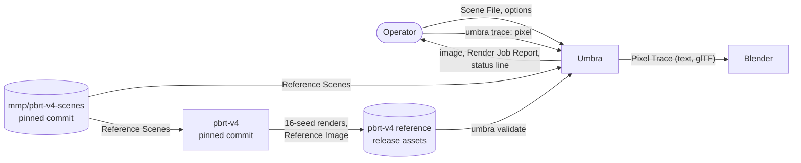
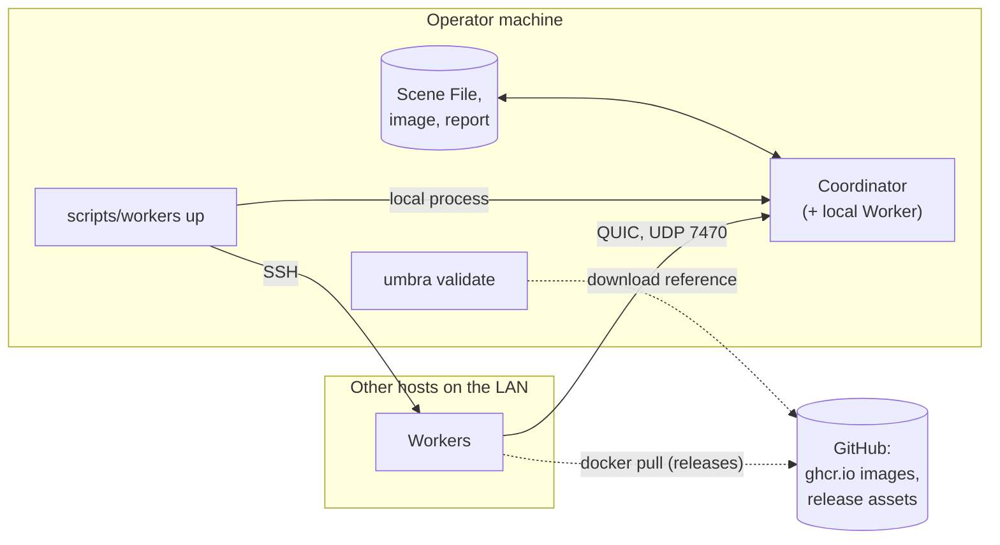

# 3. Context and Scope

Umbra is a command-line program. The operator gives it a Scene File and options; it renders on the machines of the LAN and writes an image with a Render Job Report next to it. Around that core sit the tools that check Umbra against pbrt-v4 and the tools that show how a pixel was computed.

## 3.1 Business context

| Partner | Input to Umbra | Output from Umbra |
| --- | --- | --- |
| Operator | A Scene File with its includes and assets; command-line options and overrides (`render`, `trace`, `bench`, `validate`); Ctrl-C | The final image with its Reproduction Record; the Render Job Report; the status line on stderr; Diagnostics for an invalid Scene File (§8.2, §8.10) |
| `mmp/pbrt-v4-scenes` | The Reference Scenes, downloaded at a pinned commit, never vendored (§8.4) | — |
| pbrt-v4 | Through its published reference release: 16 seeds a side and a Reference Image per Reference Scene and variant (§8.11); its speed on the same machine for QS-5 (§8.4) | — |
| Blender, or any glTF viewer | — | The resolved Scene and the paths of a Pixel Trace as glTF (§8.9) |
| Contributor | Code, through PRs | Benchmark and validation results committed to `docs/benchmarks/` and `docs/validation/`, or attached to PRs (§8.4, §8.11) |

## 3.2 Technical context

| Channel | Between | Protocol and format | Where it is decided |
| --- | --- | --- | --- |
| Command line | Operator and `umbra` | `clap` subcommands, exit codes `0`/`1`/`2`/`3`/`130` | §5.3, §8.13 |
| Files | Operator machine and Coordinator | `.pbrt` Scene File and assets in; image and versioned-JSON Render Job Report out, next to the image | §8.2, §8.10, §8.15, [ADR 0020](../adr/0020-bit-identical-exr-final-image.md) |
| Session launch | `scripts/workers up` and each host | SSH: build with `cargo` or `docker pull`, start one Worker per NUMA node under `numactl` | §7.3, [ADR 0018](../adr/0018-sessions-launched-from-the-operators-machine.md) |
| Coordinator–Worker | Coordinator and each remote Worker | QUIC (`quinn`), UDP 7470 by default, unverified TLS, `postcard` messages and raw little-endian bulk data | §8.13, [ADR 0010](../adr/0010-quic-transport-between-coordinator-and-workers.md), [ADR 0016](../adr/0016-one-render-job-per-quic-connection.md) |
| Local Worker | Coordinator and its in-process Worker | In-memory transport, same messages | §8.8 |
| Releases | CI and Linux hosts | One container image per CPU on `ghcr.io` | §7.2, [ADR 0012](../adr/0012-per-cpu-binaries-locked-to-one-commit.md) |
| Reference | GitHub release assets and `umbra validate` | `pbrt-v4-reference-<commit>` release, downloaded and hash-checked | §8.11 |
| Telemetry | Coordinator and the operator | Status line on stderr; `tracing` logs; Tracy behind the `tracy` feature. No metrics endpoint | §8.4, §8.10 |

## 3.3 Out of scope

Ruled out of this architecture, so no section of this document plans for them:

- A GPU backend (CUDA, Vulkan, Metal). Only the readiness rules of §8.12 are in scope.
- Cloud deployment, autoscaling, Workers outside the LAN.
- Out-of-core Scenes: every Worker holds the whole Scene.
- Hostile nodes: the TLS certificate is not verified, and the Session identifier and Build Identity guard only against mistakes of operation (§6.5).
- A live view: the image is seen only when the Render Job finishes.
- Input formats other than pbrt-v4's `.pbrt`, and extensions to it.
