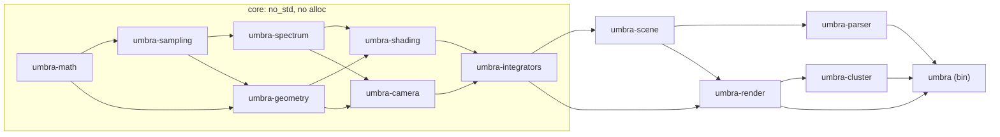

# 5. Building Block View

Umbra is a Cargo workspace of twelve crates in `crates/<name>/` ([ADR 0015](../adr/0015-layered-workspace-with-a-seven-crate-no-std-core.md), [Code organisation and module boundaries](https://github.com/sergioffpc/umbra/issues/30)). Seven `#![no_std]` crates without `alloc` hold all per-Pixel-Sample code, which [ADR 0014](../adr/0014-gpu-ready-no-std-rendering-core.md) calls the core. Five `std` crates around them build Scenes, run Render Jobs and distribute them.

## 5.1 Level 1: the workspace



Arrows point from a dependency to the crate that uses it. Only the dependencies between Umbra crates are drawn: each crate may also use any crate below it.

| Crate               | Responsibility                                                                                                                                                  | External dependencies        |
| ------------------- | --------------------------------------------------------------------------------------------------------------------------------------------------------------- | ---------------------------- |
| `umbra-math`        | Vectors, points, normals, frames, transforms, `Interval` and floating-point error bounds, `libm` wrappers                                                       | `libm`                       |
| `umbra-sampling`    | Sampling functions (warps), hashing and RNG, low-discrepancy sequences, `Sampler` and `SamplerKind`                                                             | —                            |
| `umbra-spectrum`    | `Spectrum` and `SpectrumKind`, `SampledSpectrum`, `SampledWavelengths`, RGB and color spaces                                                                    | —                            |
| `umbra-geometry`    | `Ray`, `Bounds`, interactions (carrying `MaterialId`, `LightId`, `MediumId`), Shapes and `ShapeKind`, BVH node layout and traversal                             | —                            |
| `umbra-shading`     | Textures, Materials, BxDFs, Lights and light samplers, Media, each with its `*Kind`                                                                             | —                            |
| `umbra-camera`      | Cameras and `CameraKind`, Filters, sensor RGB, camera sample generation                                                                                         | —                            |
| `umbra-integrators` | `SceneView`, the per-Pixel-Sample body of each integrator, the `Recorder` trait                                                                                 | —                            |
| `umbra-scene`       | Owning `Scene` (arenas), `SceneBuilder`, deterministic BVH construction, `RenderJobOptions`                                                                     | `serde`                      |
| `umbra-parser`      | The `.pbrt` adapter: tokenising, includes, assets, strict validation, content hash                                                                              | `nom`                        |
| `umbra-render`      | Renders Work Units into Work Results in one process; Film and its merge order; Pixel Traces and glTF export; writing and reading the EXR final image            | `rayon`, `exr`               |
| `umbra-cluster`     | Coordinator and Worker: wire protocol, QUIC, heartbeats, scheduling, reassignment, tail, local Worker, Build Identity admission, status line, Render Job Report | `tokio`, `quinn`, `postcard` |
| `umbra`             | The binary: `clap` subcommands `render`, `worker`, `trace`, `bench`, `validate`; `tracing` setup; the statistics of `bench` and `validate`                      | `clap`, `tracing`            |

The final image is an EXR written by `umbra-render` with the `exr` crate, carrying the Reproduction Record in its header (§8.15, [ADR 0020](../adr/0020-bit-identical-exr-final-image.md)).

## 5.2 Level 2: the core

The seven core crates follow pbrt-v4's dependency order. pbrt-v4's cycles are broken by IDs. An interaction in `umbra-geometry` names its Material, area Light and Medium by `u32` ID ([ADR 0008](../adr/0008-index-handle-arenas-and-allocation-free-rendering.md)), and turning it into a BSDF happens in `umbra-shading`. Camera and shading are parallel branches.

Inside a core crate, each pbrt-v4 chapter or section is a module, for example `umbra_shading::bxdfs`. Interfaces keep pbrt-v4's names and are dispatched through closed `*Kind` enums ([ADR 0006](../adr/0006-closed-enum-dispatch-for-rendering-interfaces.md)).

| Crate               | pbrt-v4 chapters | Question it answers                                               |
| ------------------- | ---------------- | ----------------------------------------------------------------- |
| `umbra-math`        | 3, 6.8, B.2      | How to operate on numbers and geometric quantities                |
| `umbra-sampling`    | 2, 8, A          | How to choose numbers                                             |
| `umbra-spectrum`    | 4.5–4.6          | How light is represented                                          |
| `umbra-geometry`    | 6–7              | Where a ray hits                                                  |
| `umbra-shading`     | 9–12             | What light does at that point                                     |
| `umbra-camera`      | 5, 8.8           | How a Pixel Sample becomes a ray, and radiance becomes sensor RGB |
| `umbra-integrators` | 13–15            | How one Pixel Sample is computed from start to end                |

Per-sample code receives a `SceneView<'_>` of borrowed arena slices, never `&Scene` (ADR 0014).

Every core crate has a `serde` feature, off by default, that derives `Serialize` and `Deserialize` for its Scene arena types with `serde`'s `default-features = false`. `umbra-scene` turns it on. CI builds all seven crates for `aarch64-unknown-none` with the feature off.

## 5.3 Level 2: interfaces outside the core

The signatures below are the contracts between crates. Error types and option structs are sketched, not final.

### `umbra-parser`

```rust
/// Reads a Scene File with its includes and assets, validates it strictly, builds the Scene.
pub fn parse(scene_file: &Path) -> Result<Parsed, Diagnostics>;
pub struct Parsed { pub scene: Scene, pub options: RenderJobOptions, pub content_hash: ContentHash }
```

`parse` is the only public function. `Diagnostics` lists every error with its file, line and column, and nothing is built when there is one ([ADR 0003](../adr/0003-pbrt-v4-scene-files-parsed-on-the-coordinator.md)). The content hash covers the Scene File, its includes and its assets, for the Reproduction Record (§8.9).

### `umbra-scene`

```rust
impl SceneBuilder {
    pub fn add_shape(&mut self, shape: ShapeKind) -> ShapeId;   // one add_* per arena
    pub fn build(self) -> Result<Scene, SceneError>;           // builds the BVH
}
impl Scene { pub fn view(&self) -> SceneView<'_>; }
```

`SceneBuilder` is the seam that makes a Scene independent of its file format. The parser is one adapter, and tests that build Scenes directly are the other. `build` constructs the BVH deterministically ([ADR 0004](../adr/0004-deterministic-film-for-a-fixed-render-job.md)) and checks that its depth fits the fixed traversal stack. Replication sends the builder's arenas, without the BVH, and each Worker calls `build` itself. `RenderJobOptions` lives here because render, cluster and the binary all need it. The `.pbrt` directives fill it, and the binary applies command-line overrides on top.

### `umbra-render`

```rust
impl<'s> Renderer<'s> {
    pub fn new(scene: &'s Scene, options: &RenderJobOptions) -> Result<Self, RenderError>;
    pub fn render(&self, unit: WorkUnit, cancel: &Cancellation) -> Rendered;   // Done(WorkResult) | Cancelled
    pub fn trace(&self, request: &TraceRequest) -> Vec<PixelTrace>;
}
impl Film {
    pub fn new(options: &RenderJobOptions) -> Self;
    pub fn accept(&mut self, result: WorkResult) -> Acceptance;   // Merged | Buffered | Duplicate | Conflict
    pub fn finish(self, record: ReproductionRecord) -> Image;
}
```

- `Renderer` hides everything between a Work Unit and its Work Result: the `dyn Integrator`, per-thread buffers, `par_iter` over rows, Anomalous Pixel Sample collection and the choice of `Recorder`. `render` may be called concurrently for several Work Units (§8.8). Cancellation is cooperative, checked between rows, and serves the speculative tail.
- `trace` re-runs Pixel Samples through the same code path as `render`, with a `TraceRecorder`. That shared path is what the bit-identical oracle tests (§8.9).
- `Film` owns the merge order. It accepts Work Results in any order, buffers early arrivals, and merges each Tile's Passes in order (ADR 0004). It also compares duplicates by hash. The scheduler decides what to assign, never how results are merged.

### `umbra-cluster`

```rust
pub struct RenderJob { pub scene: Scene, pub options: RenderJobOptions, pub record: ReproductionRecord }

pub fn coordinate(job: RenderJob, options: &CoordinatorOptions, status: &mut dyn io::Write)
    -> Result<RenderJobOutcome, ClusterError>;   // { image: Image, report: RenderJobReport }
pub fn work(options: &WorkerOptions) -> Result<(), ClusterError>;
```

- Both functions are synchronous. Each owns its `tokio` runtime, so callers never see `async`, QUIC, discovery, heartbeats or scheduling.
- `work` runs until the Worker is stopped, joining the Render Jobs of its Cluster one after another (§8.13). `WorkerOptions` carries the Cluster Name, the thread count and the Build Identity.
- `umbra-cluster` receives a parsed Scene and does not depend on `umbra-parser`.
- `CoordinatorOptions` carries the listen address, the heartbeat and death timeouts, `LocalWorker::{Enabled, Disabled}`, `Discovery::{Announce(ClusterName), Off}` and the Build Identity to admit. A Coordinator with `Discovery::Off` announces nothing and renders with its local Worker alone.
- A distributed `render`, a single-Worker `bench` and a 16-seed `validate` all go through `coordinate`, with different options.
- The status line goes to the `io::Write` it is given (§8.10). The Render Job Report is returned, not written, and the caller decides where it goes.

### `umbra` (binary)

The binary has `clap` derive subcommands: `render`, `worker`, `trace`, `bench` and `validate`.

- **Parsing.** The binary parses the Scene File, applies command-line overrides and builds the Reproduction Record. It then calls `umbra-cluster`, or `umbra-render` for `trace`.
- **`bench` and `validate`.** Their logic is modules of the binary: the statistical tests (Welch, Benjamini–Hochberg, confidence intervals) and the comparison of Render Job Reports and images.

## 5.4 Workspace conventions

| Concern     | Rule                                                                                                                                                                                                                                                                                                                                 |
| ----------- | ------------------------------------------------------------------------------------------------------------------------------------------------------------------------------------------------------------------------------------------------------------------------------------------------------------------------------------ |
| Layout      | Crates in `crates/<name>/`. The root `Cargo.toml` is a `[workspace]` with `members = ["crates/*"]`, `resolver = "3"` and the build profiles.                                                                                                                                                                                         |
| Inheritance | `[workspace.package]` (version, edition, `rust-version`, license, repository, authors), `[workspace.lints]` (every lint in force) and `[workspace.dependencies]`. Each crate sets `lints.workspace = true`.                                                                                                                          |
| Versioning  | One workspace version and `publish = false` everywhere. The Build Identity is the commit ([ADR 0012](../adr/0012-per-cpu-binaries-locked-to-one-commit.md)).                                                                                                                                                                         |
| Core crates | `#![no_std]`, no `extern crate alloc`; every dependency builds without `std`. CI builds them for `aarch64-unknown-none`.                                                                                                                                                                                                             |
| Tests       | Unit tests in each crate. χ², `pdf`, normalisation and reciprocity tests ([ADR 0013](../adr/0013-statistical-validation-against-a-published-pbrt-v4-reference.md)) live in the crate that owns the sampling routine. Cross-crate tests (golden Film hashes, the trace oracle, the counting allocator) live in `crates/umbra/tests/`. |
| Benchmarks  | `divan` micro-benchmarks in each crate's `benches/`. End-to-end measurement is `umbra bench` (§8.4).                                                                                                                                                                                                                                 |
