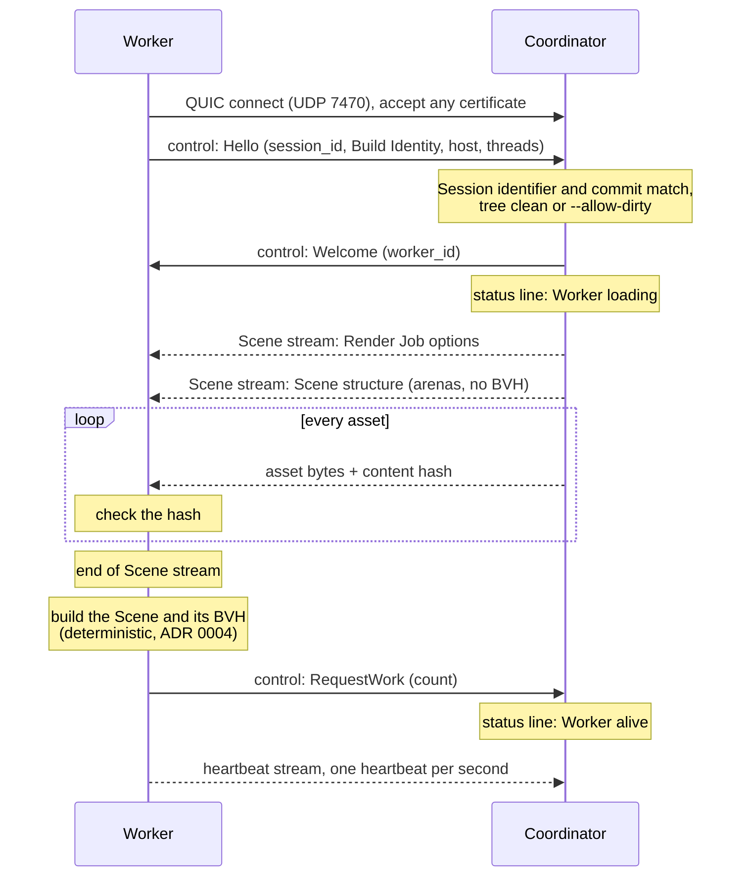
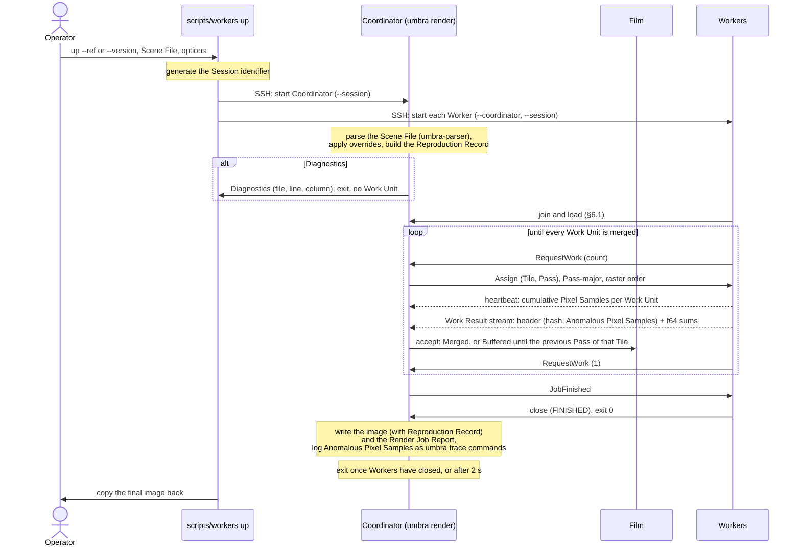
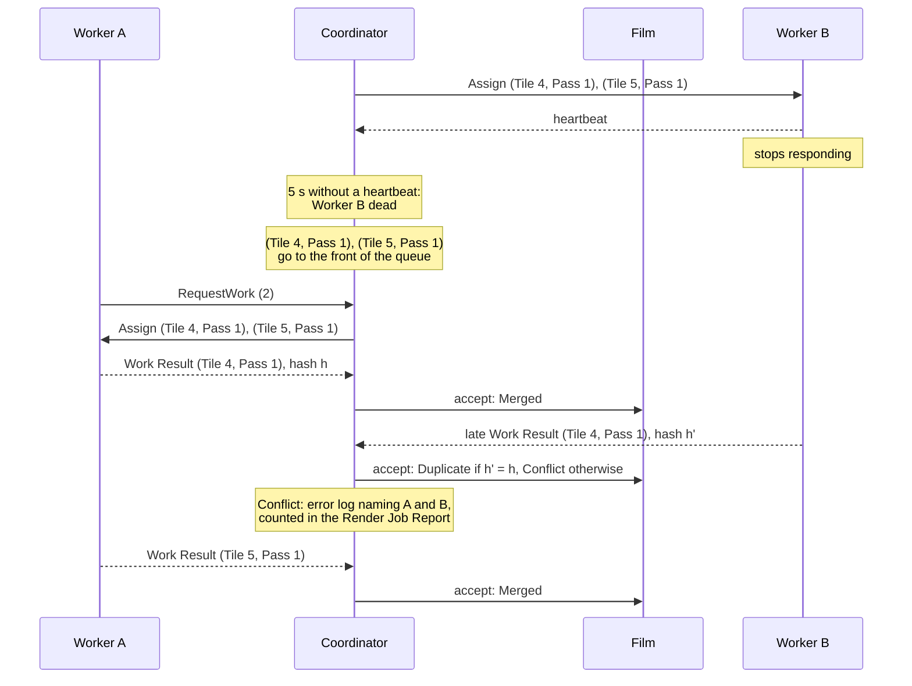
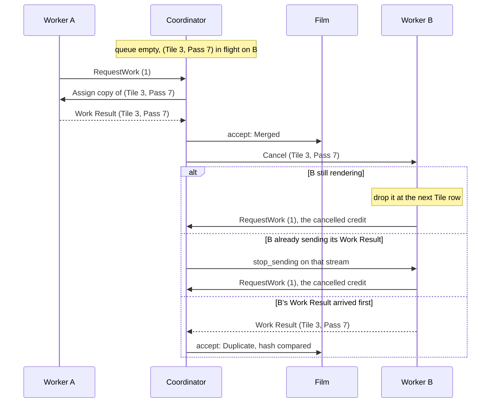
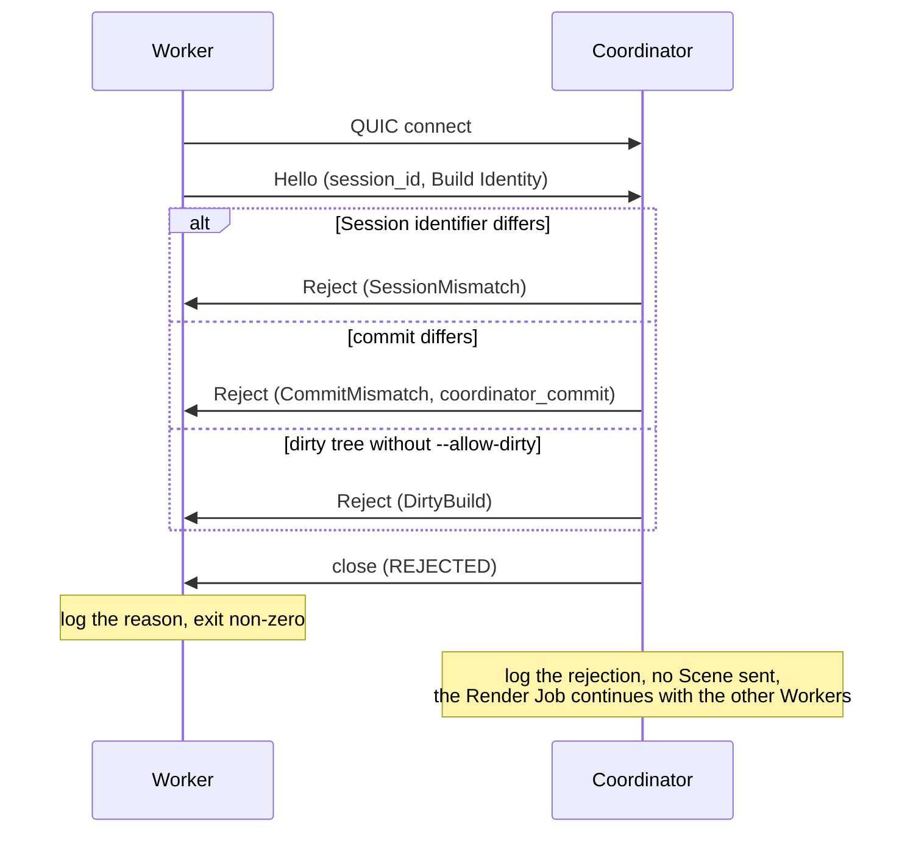
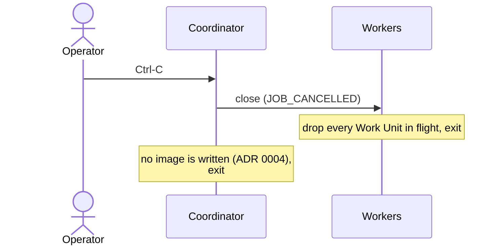

# 6. Runtime View

The scenarios a Session runs through, from the decisions in [ADR 0004](../adr/0004-deterministic-film-for-a-fixed-render-job.md) (deterministic merge), [ADR 0009](../adr/0009-pull-based-pass-major-scheduling.md) (scheduling), [ADR 0012](../adr/0012-per-cpu-binaries-locked-to-one-commit.md) (Build Identity), [ADR 0015](../adr/0015-one-render-job-per-quic-connection.md) and [§8.13](08-crosscutting-concepts.md#813-wire-protocol) (wire protocol). The messages are those of §8.13; the rules behind each step are in §8.8 and §8.13 and are not repeated here.

Two parts of these scenarios are still open and are marked where they appear: how a Session starts and who may join it ([Session start-up and Worker joining](https://github.com/sergioffpc/umbra/issues/59)), and how connections close when a Worker is declared dead or a Render Job is cancelled ([Closing connections: dead Workers and cancellation](https://github.com/sergioffpc/umbra/issues/60)).

## 6.1 Worker join and Scene transfer

A Worker started by `scripts/workers up` connects to the Coordinator, is admitted, receives the whole Scene and announces it is ready by asking for work.

1. The Worker is the QUIC client. It accepts the Coordinator's self-signed certificate without checking it; admission rests on the handshake instead.
2. `Hello` carries the Session identifier from `scripts/workers up` and the Build Identity. A mismatch ends here (§6.5).
3. The Scene stream carries only what a Worker needs: the Render Job options (seed, Tile size, Pixel Samples per Pass, total Pixel Samples per pixel), the Scene structure, and every asset. There is no asset cache, so every connection receives everything. An asset whose hash does not match ends the Worker with `Fatal` (§6.3).
4. Each Worker builds its own BVH from the Scene. Its first `RequestWork` is the readiness signal, and the Coordinator assigns nothing before it. The time from `Welcome` to that request is the Worker's loading phase in the Render Job Report.

The in-process local Worker skips the network: it receives the same typed messages through the in-memory transport, and shares the Coordinator's Scene.

Open ([Session start-up and Worker joining](https://github.com/sergioffpc/umbra/issues/59)): whether the Coordinator parses the Scene before it listens, whether a Worker retries a connection made before the Coordinator is up, how a Worker joins a Session that is already rendering, and when the heartbeat stream starts. If it starts only with the first `RequestWork`, the 5 s death rule does not apply to a loading Worker, and a Worker that hangs while loading is never detected.

## 6.2 A Render Job from submission to image

The operator starts a Session from their own machine and gets the final image back.

1. The binary parses the Scene File once ([ADR 0003](../adr/0003-pbrt-v4-scene-files-parsed-on-the-coordinator.md)). A file with any error produces no Work Unit.
2. `umbra-cluster`'s `coordinate` starts the optional local Worker and accepts remote Workers (§6.1).
3. Scheduling follows §8.8. Work Units go out Pass by Pass in raster Tile order, and Pass p of a Tile waits until Pass p − 2 of that Tile is merged. A Worker keeps about two Work Units in flight per eight threads, and returns one credit per Work Result.
4. The Coordinator checks each Work Result's hash on receipt. The Film merges each Tile's Work Results in Pass order and holds the one early arrival per Tile that scheduling allows (ADR 0004).
5. The status line on the Coordinator's stderr (§8.10) shows the current Pass, the percentage of Pixel Samples merged or in flight, each Worker's state and the ETA throughout.
6. After the last merge, `JobFinished` releases every Worker. The image and its Render Job Report are written next to each other, and the image only exists once every Pass has been rendered.

Open ([Session start-up and Worker joining](https://github.com/sergioffpc/umbra/issues/59)): how the Scene File and its assets reach the Coordinator's host when it is not the operator's machine, and what connected Workers see when parsing fails.

## 6.3 Worker failure, reassignment and a duplicate Work Result

Worker B stops sending heartbeats while two Work Units are in flight. One of them was already being sent and arrives after its reassigned copy.

1. A Worker is dead when its connection closes, when it sends `Fatal`, or after 5 s without a heartbeat. There is no per-Work-Unit timeout.
2. Its Work Units in flight go to the front of the queue, because they are the ones holding back ordered merges.
3. The first Work Result for a Work Unit is merged, even from a Worker already declared dead. Any later one is compared by hash and discarded. Equal hashes are the expected outcome (`Duplicate`). Different hashes (`Conflict`) are a bug in determinism and are logged as an error naming both Workers. The Film keeps the first.
4. With no Workers left, the Render Job waits. A Worker that comes back joins as a new Worker (§6.1).

A Worker whose connection merely went quiet but whose render pool is still progressing is not dead: it keeps sending heartbeats. If its Pixel Sample count stops growing for 30 s, the status line shows it as `stalled` and nothing is reassigned. The speculative tail (§6.4) covers it at the end.

Open ([Closing connections: dead Workers and cancellation](https://github.com/sergioffpc/umbra/issues/60)): whether the Coordinator closes the connection of a Worker it declared dead by heartbeat, and with which close code, given that closing it would cut off the late Work Result shown above.

## 6.4 Speculative tail

At the end of the last Pass, the queue is empty while Worker B, the slowest, still renders a Work Unit.

1. When the queue is empty and a Worker has pending demand, the Coordinator assigns it a copy of the oldest Work Unit still in flight. Each Work Unit gets at most one copy.
2. The first Work Result wins. The other copy is cancelled, or, if it arrives anyway, compared by hash and discarded as in §6.3.
3. A cancelled Work Unit gives its credit back, so the Worker can take another copy while any remain.

Copies happen in every Render Job, so the hash comparison of ADR 0004 runs routinely, not only after failures.

## 6.5 A rejected Worker

A Worker from another Session, or built from another commit, reaches the Coordinator.

1. The Coordinator checks the Session identifier, the commit of the Build Identity and the dirty flag ([ADR 0012](../adr/0012-per-cpu-binaries-locked-to-one-commit.md)). The target CPU is informational and never rejects.
2. Nothing of the Scene is sent before `Welcome`, so a rejected Worker costs the Render Job nothing.
3. `--allow-dirty` admits dirty builds and is recorded in the Render Job Report.

The certificate is never checked, so these rejections catch mistakes of operation, such as a Worker left over from another Session, and not hostile nodes, which are out of scope (ADR 0015).

## 6.6 Ctrl-C cancellation

The operator cancels a running Render Job on the Coordinator.

1. A Render Job either renders every Pass or produces no image. There is no partial image and no time budget (ADR 0004).
2. Closing a connection with `JOB_CANCELLED` ends every stream on it, so Workers need no separate `Cancel` per Work Unit.

Open ([Closing connections: dead Workers and cancellation](https://github.com/sergioffpc/umbra/issues/60)): how Ctrl-C in `scripts/workers up`, which runs everything over SSH, reaches the Coordinator, what Ctrl-C on a Worker means, the exit codes on `JOB_CANCELLED`, and whether a cancelled Render Job still writes its Render Job Report.
