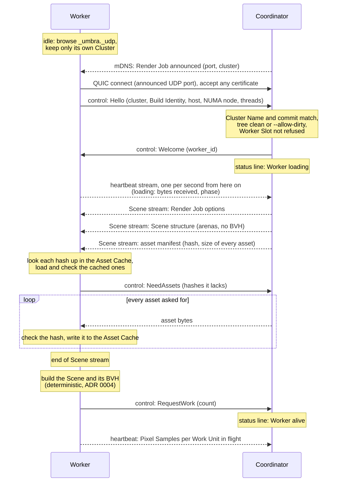
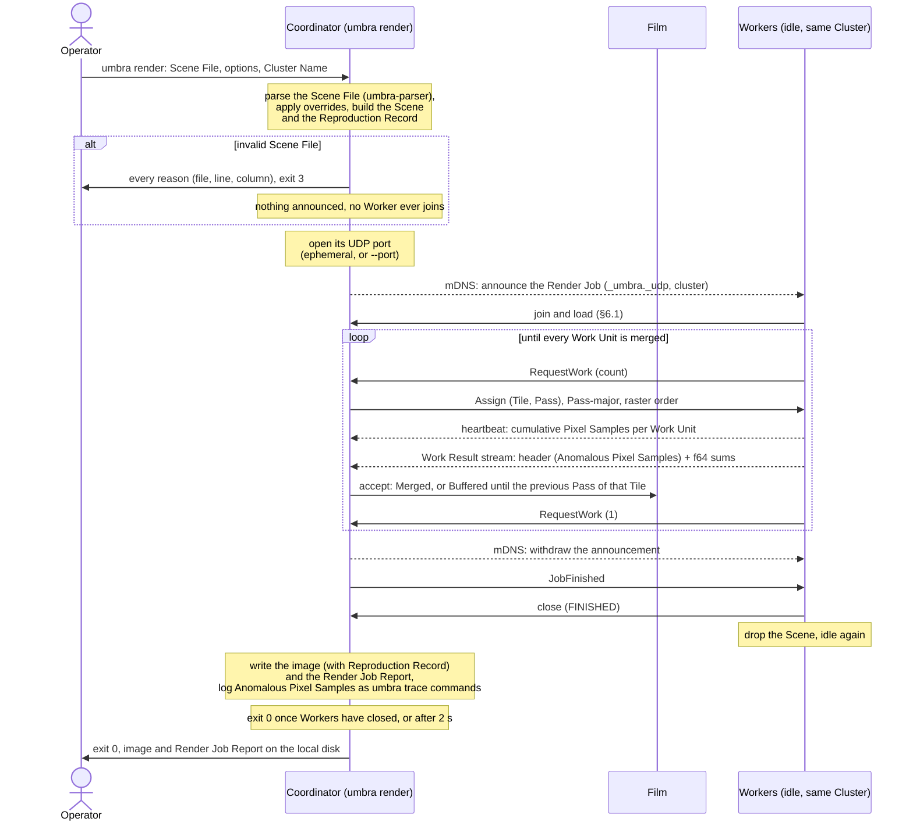
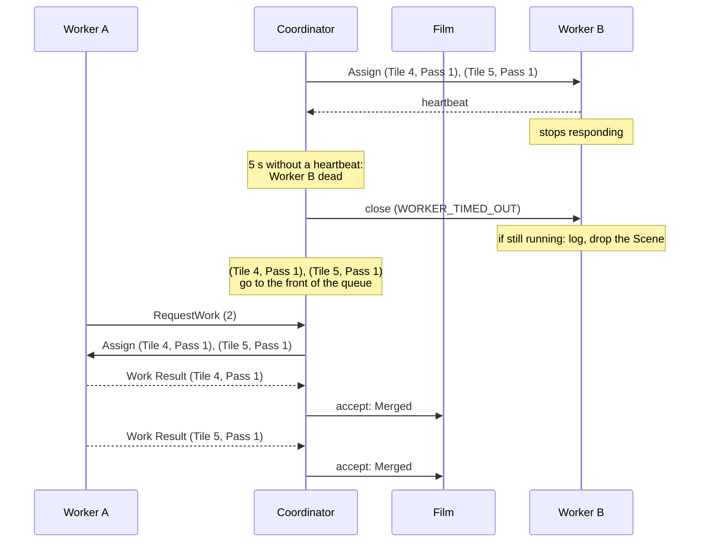
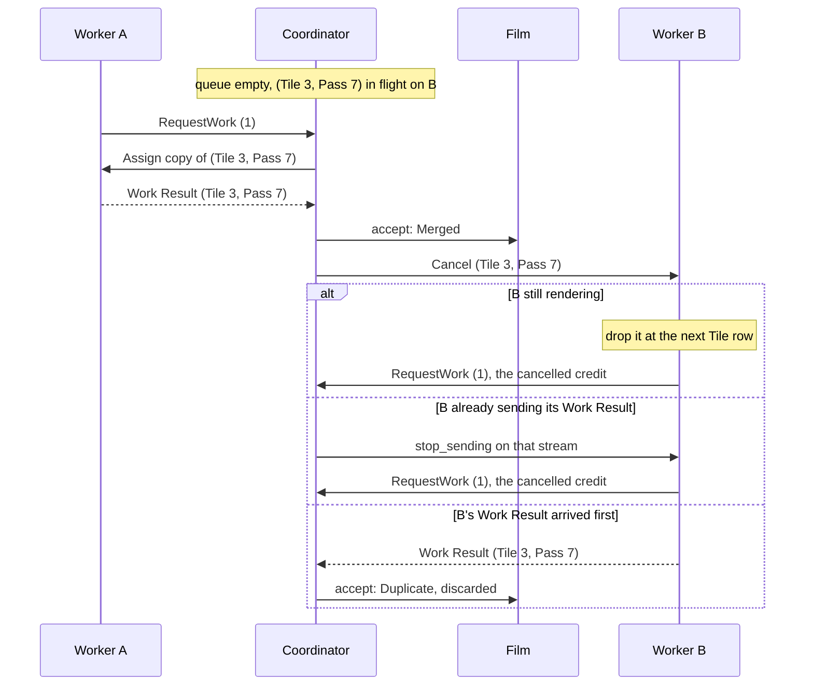
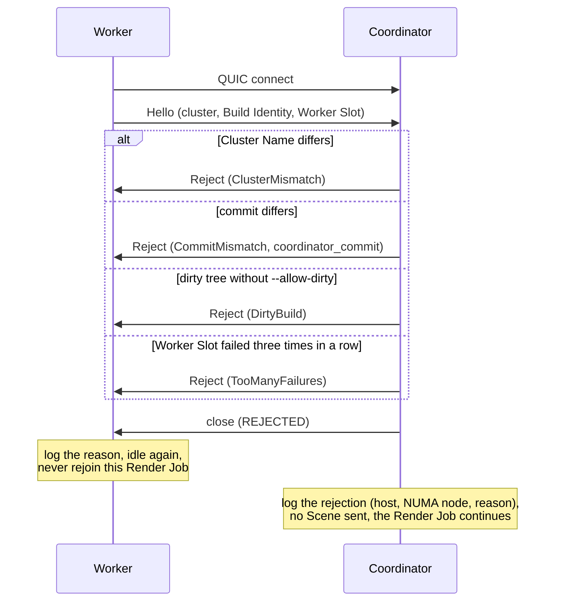
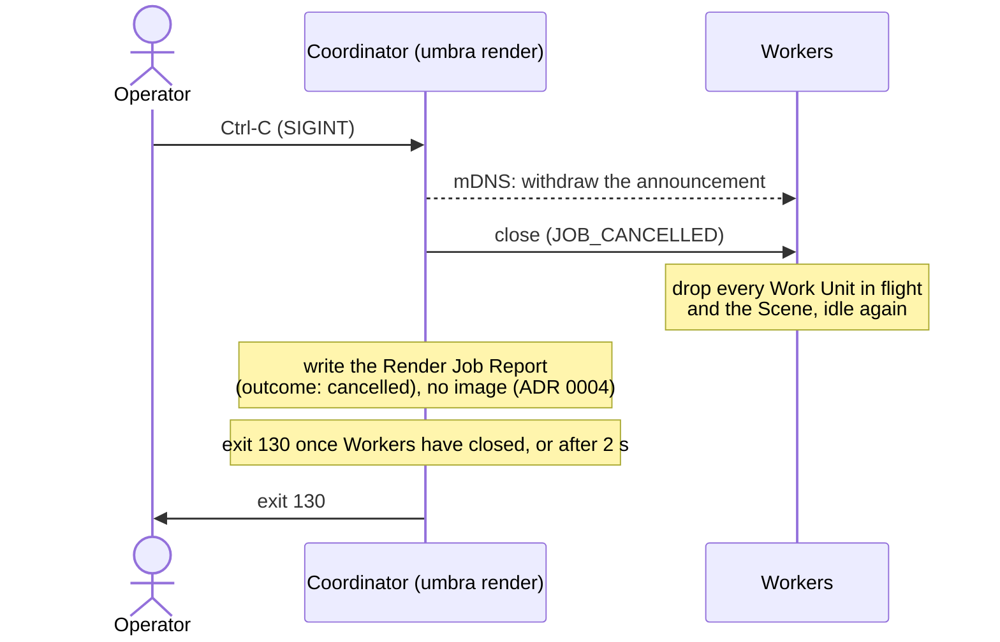

# 6. Runtime View

The scenarios a Render Job runs through, from the decisions in [ADR 0004](../adr/0004-deterministic-film-for-a-fixed-render-job.md) (deterministic merge), [ADR 0009](../adr/0009-pull-based-pass-major-scheduling.md) (scheduling), [ADR 0012](../adr/0012-per-cpu-binaries-locked-to-one-commit.md) (Build Identity), [ADR 0021](../adr/0021-plug-and-play-workers-in-a-named-cluster.md) (discovery, joining and rejoining), [ADR 0016](../adr/0016-one-render-job-per-quic-connection.md), [ADR 0030](../adr/0030-a-bounded-asset-cache-on-each-worker-host.md) (Asset Cache) and [§8.13](08-crosscutting-concepts.md#813-wire-protocol) (wire protocol). The messages are those of §8.13. The rules behind each step, and the values they use, are defined in §8.8 and §8.13. A scenario repeats a value only where a step needs it, and §8.13 wins if the two ever disagree.

How a Render Job starts and who may join it was first settled in [Session start-up and Worker joining](https://github.com/sergioffpc/umbra/issues/59), then replaced by plug-and-play Workers in a named Cluster (ADR 0021). How connections close when a Worker is declared dead or a Render Job is cancelled was settled in [Closing connections: dead Workers and cancellation](https://github.com/sergioffpc/umbra/issues/60).

## 6.1 Worker join and Scene transfer

An idle Worker discovers a Render Job of its Cluster (§6.2). It connects to the Coordinator, is admitted, receives the whole Scene and announces it is ready by asking for work. A Worker that rejoins after a failure goes through exactly the same steps.

1. The Worker is the QUIC client. It learns the Coordinator's address and port from the DNS-SD announcement (§8.13). It accepts the Coordinator's self-signed certificate without checking it, because admission rests on the handshake instead. If the connection fails, the Worker retries for as long as the Render Job is announced: after 2 s, then 10 s, then every 30 s.
2. `Hello` carries the Cluster Name, the Build Identity and the Worker Slot (host and NUMA node). A mismatch ends the join here (§6.5).
3. The Scene stream carries only what a Worker needs: the Render Job options (seed, Tile size, Pixel Samples per Pass, total Pixel Samples per pixel), the Scene structure, the asset manifest, and the assets the Worker asked for with `NeedAssets` because its Asset Cache lacks them (ADR 0030). A Worker with `--cache-size 0`, or whose cache cannot be used, asks for every asset. A received asset whose hash does not match ends the Worker's connection with `Fatal` (§6.3). A cached file whose hash does not match is deleted and asked for like a missing one.
4. Each Worker builds its own BVH from the Scene. Its first `RequestWork` is the readiness signal, and the Coordinator assigns nothing before it. The time from `Welcome` to that request is the Worker's loading phase in the Render Job Report.
5. The heartbeat starts at `Welcome`, from a task independent of loading, so the 5 s death rule covers a loading Worker. While loading, it carries the Scene bytes received, the Scene bytes read from the Asset Cache, and the phase (`receiving`, `building BVH`). If loading stops progressing for 30 s, the Worker is shown as `stalled`, never dead: it holds no Work Units, so it blocks nothing.
6. However the connection closes, the Worker drops the Scene and is idle again (§8.13).

The CPU Local Worker skips the network. It receives the same typed messages through the in-memory transport, and shares the Coordinator's Scene, so it has no Asset Cache. A GPU Local Worker runs in a child process that the Coordinator starts with its address, so it connects over QUIC on loopback without discovery and joins like a remote Worker, receiving the Scene and using its host's Asset Cache ([ADR 0026](../adr/0026-gpu-workers-from-the-first-milestone.md)).

## 6.2 A Render Job from submission to image

The Workers of the Cluster are already running and idle. The operator runs `umbra render` on their own machine, which hosts the Coordinator, and the image is written there.

1. The Coordinator reads the Scene File and its assets from the operator's local disk and parses them once ([ADR 0003](../adr/0003-pbrt-v4-scene-files-parsed-on-the-coordinator.md)). Only then does it open its UDP port and announce the Render Job ([ADR 0021](../adr/0021-plug-and-play-workers-in-a-named-cluster.md)). On an invalid Scene File the Coordinator exits before anything is announced, so no Worker ever joins and no close code is needed.
2. `umbra-cluster`'s `coordinate` starts a Local Worker per Render Device of its machine (§7.3), announces the Render Job in its Cluster and accepts remote Workers (§6.1). It does not wait for Workers: the Render Job starts with the first `RequestWork`, local or remote. A Worker that starts or becomes idle later joins the Render Job in progress.
3. Scheduling follows §8.8. Work Units go out Pass by Pass in raster Tile order. A Worker keeps as many Work Units in flight as its Render Device declares (about two per eight threads on a CPU, about 16 on a GPU), and returns one credit per Work Result.
4. The Film merges each Work Result as soon as it arrives, in any order (ADR 0022).
5. The status line on the Coordinator's stderr (§8.10) shows the current Pass, the percentage of Pixel Samples merged or in flight, each Worker's state and the ETA throughout.
6. After the last merge, the Coordinator withdraws its announcement, and `JobFinished` then releases every Worker, which drops the Scene and is idle again. The image and its Render Job Report are written next to each other on the operator's machine. The image only exists once every Pass has been rendered.
7. A Worker that fails while the Render Job runs rejoins it as a new Worker (§6.3). The Coordinator refuses a Worker Slot whose Workers have failed three times in a row (§8.13). When no Worker is alive and there is no local Worker, the status line shows `waiting: no Workers` until a Worker joins or the operator presses Ctrl-C (§6.6).

## 6.3 Worker failure and reassignment

Worker B stops sending heartbeats while two Work Units are in flight. The Coordinator closes its connection and reassigns both, and nothing more arrives from Worker B.

1. A Worker is dead when its connection closes, when it sends `Fatal`, or after 5 s without a heartbeat. There is no per-Work-Unit timeout. A Worker dead by heartbeat has its connection closed with `WORKER_TIMED_OUT`, so a dead Worker is always a closed connection, and a Work Result it was still sending is lost. Since the QUIC idle timeout equals the death time, this matters only when other traffic kept the connection alive.
2. Its Work Units in flight go to the front of the queue, because they are the oldest work still missing.
3. The first Work Result for a Work Unit is merged. Any later one, from a speculative copy (§6.4) or from a reassigned Work Unit whose stream had already ended, is a `Duplicate` and is discarded unread. The Cluster is assumed healthy, so the two are not compared (ADR 0022).
4. If Worker B is still running, it rejoins the Render Job after 2 s as a new Worker (§6.1). If its process died, its supervisor restarts it, and the new process joins the same way. Each failure counts against Worker B's Worker Slot (§8.13). With no Workers left, the Render Job waits.

A Worker whose connection merely went quiet but whose render pool is still progressing is not dead: it keeps sending heartbeats. If its Pixel Sample count stops growing for 30 s, the status line shows it as `stalled` and nothing is reassigned. The speculative tail (§6.4) covers it at the end.

## 6.4 Speculative tail

At the end of the last Pass, the queue is empty while Worker B, the slowest, still renders a Work Unit.

1. When the queue is empty and a Worker has pending demand, the Coordinator assigns it a copy of the oldest Work Unit still in flight. Each Work Unit gets at most one copy.
2. The first Work Result wins. The other copy is cancelled, or, if it arrives anyway, discarded unread as in §6.3.
3. A cancelled Work Unit gives its credit back, so the Worker can take another copy while any remain.

## 6.5 A rejected Worker

A Worker built from another commit, or one whose Worker Slot has failed three times in a row, reaches the Coordinator.

1. The Coordinator checks the Cluster Name, the commit of the Build Identity and the dirty flag ([ADR 0012](../adr/0012-per-cpu-binaries-locked-to-one-commit.md)), and the failure count of the Worker Slot ([ADR 0021](../adr/0021-plug-and-play-workers-in-a-named-cluster.md)). The target CPU is informational and never rejects. A Worker of another Cluster normally never connects, because it ignores announcements of other Clusters. The check catches it if it does.
2. Nothing of the Scene is sent before `Welcome`, so a rejected Worker costs the Render Job nothing.
3. `--allow-dirty` admits dirty builds and is recorded in the Render Job Report.
4. A rejected Worker stays up and joins the next Render Job it can. The Coordinator logs every `CommitMismatch` with the Worker's host, so the operator knows which hosts still need to be rebuilt and restarted for the current commit.

The certificate is never checked, so these rejections catch mistakes of operation, such as a Worker not yet rebuilt for the current commit. They do not protect against hostile nodes, which are out of scope ([ADR 0016](../adr/0016-one-render-job-per-quic-connection.md), §3.3).

## 6.6 Ctrl-C cancellation

The operator presses Ctrl-C in the terminal running `umbra render`.

1. A Render Job either renders every Pass or produces no image. There is no partial image and no time budget (ADR 0004).
2. Closing a connection with `JOB_CANCELLED` ends every stream on it, so Workers need no separate `Cancel` per Work Unit.
3. Workers are not stopped. They return to idle and join the next Render Job announced in their Cluster.
4. A second Ctrl-C makes the Coordinator exit at once. Its Workers then detect the lost Coordinator through the QUIC idle timeout and return to idle. The announcement is already withdrawn, so they do not rejoin.
5. The cancelled Render Job still leaves its Render Job Report, with `outcome: "cancelled"`; `umbra bench` and `umbra validate` reject it (§8.10). Exit codes are in §8.13.
6. Ctrl-C or `SIGTERM` on a single Worker stops only that Worker. It closes with `WORKER_STOPPED` and exits 0, and the Coordinator reassigns its Work Units as in §6.3. A stopped Worker does not count as a failure of its Worker Slot.
