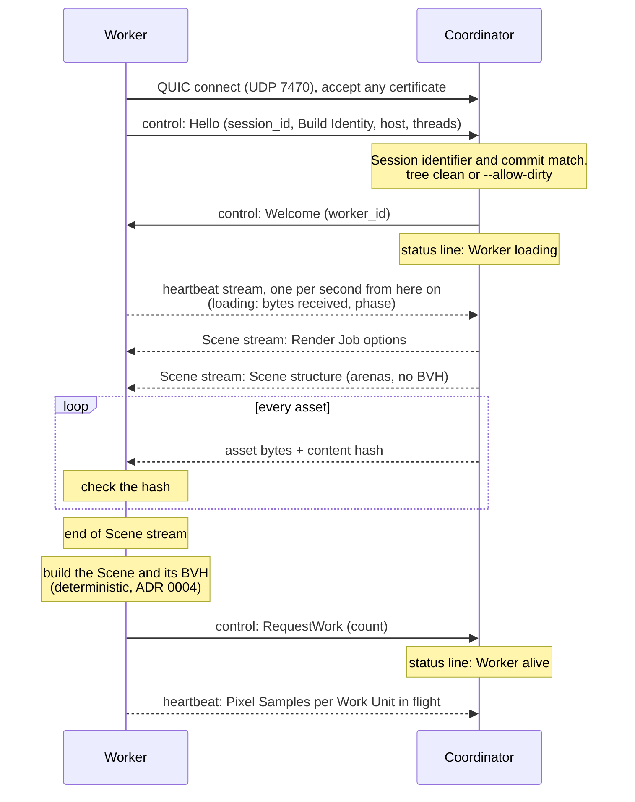
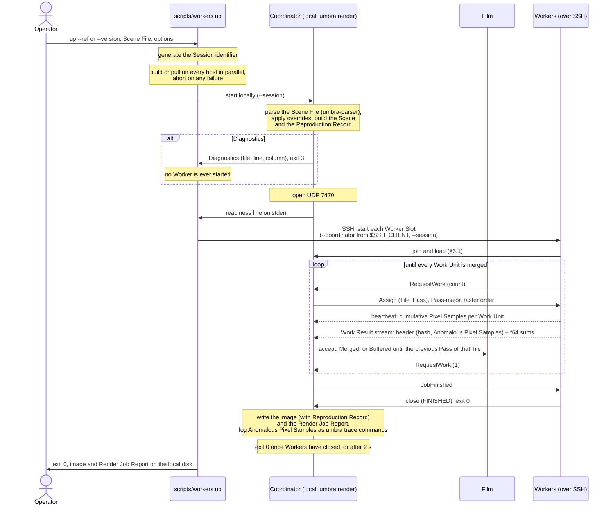
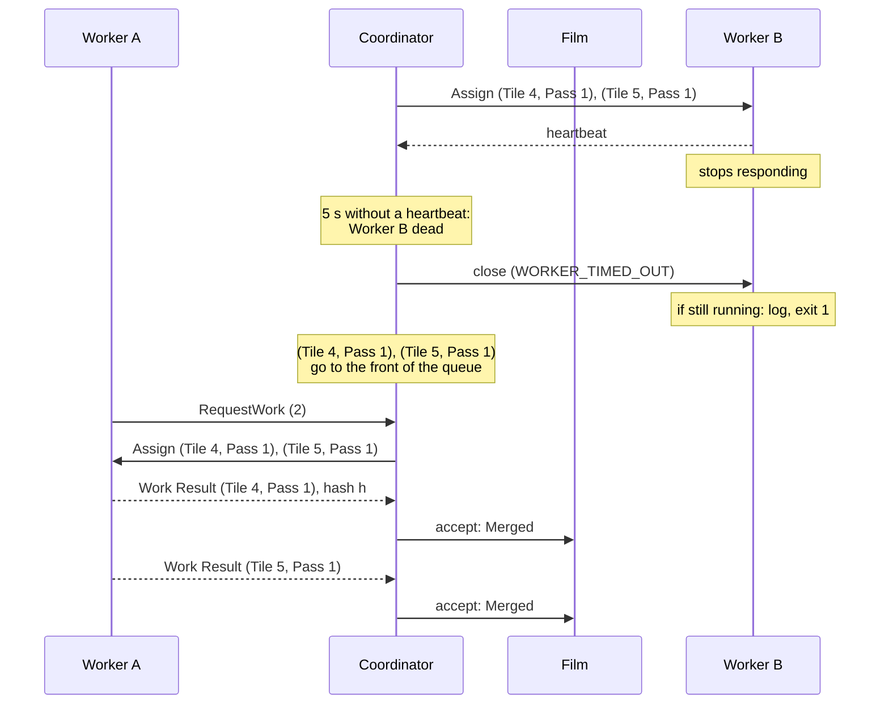
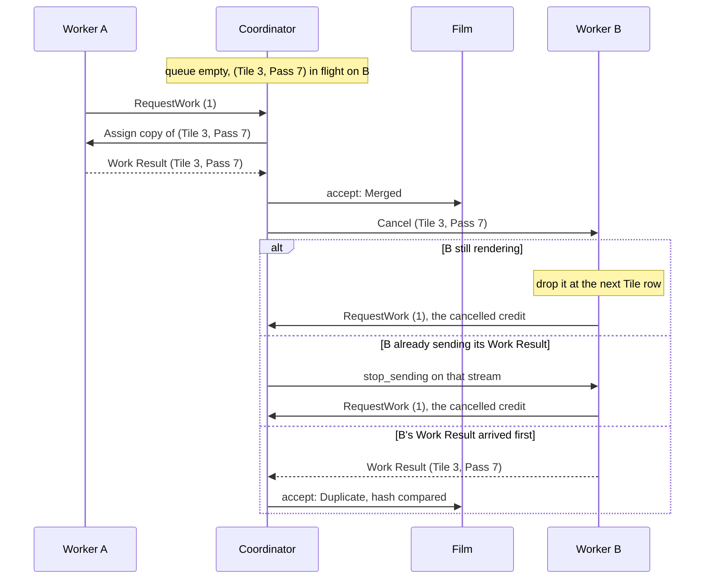
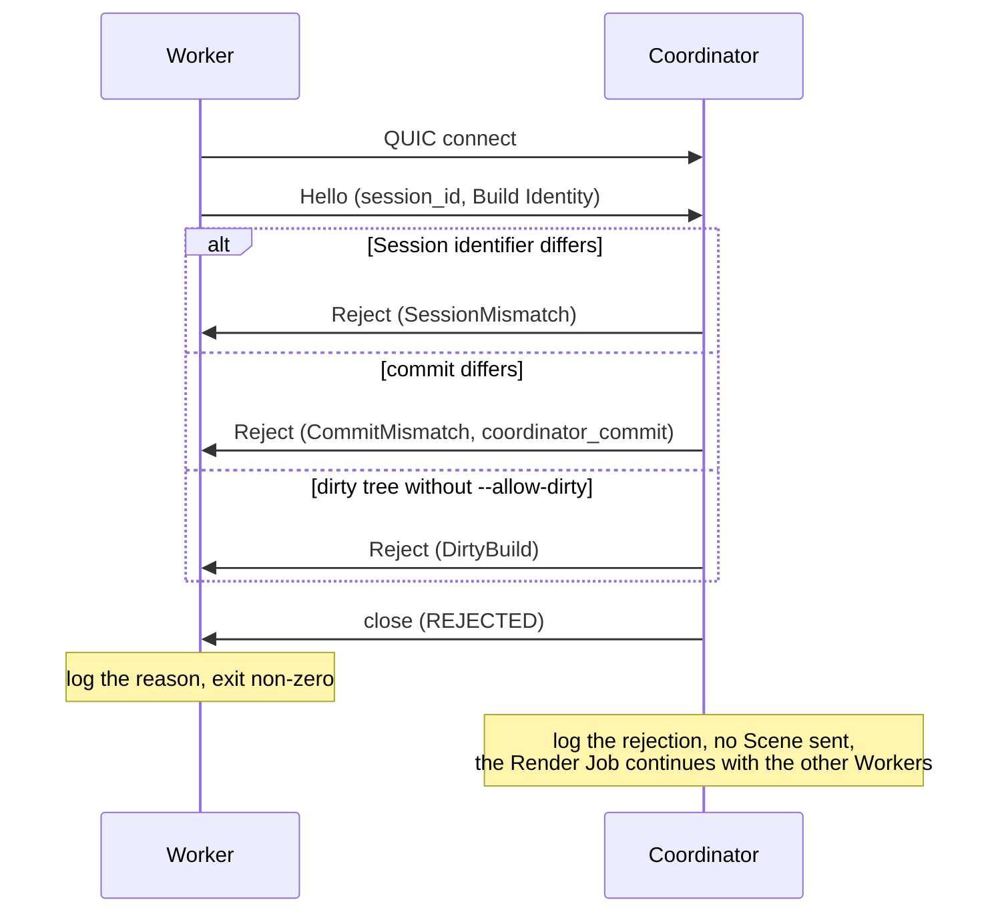
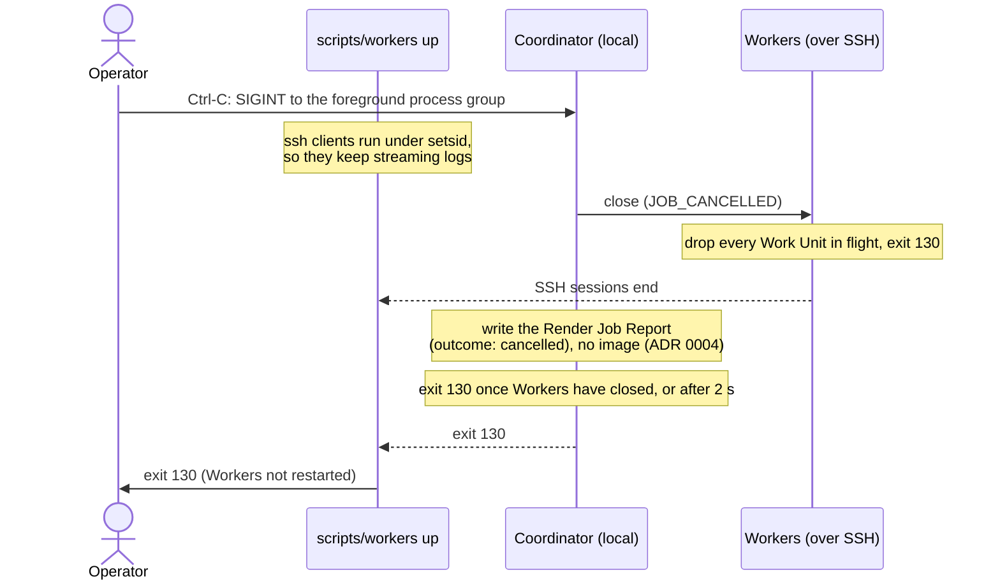

# 6. Runtime View

The scenarios a Session runs through, from the decisions in [ADR 0004](../adr/0004-deterministic-film-for-a-fixed-render-job.md) (deterministic merge), [ADR 0009](../adr/0009-pull-based-pass-major-scheduling.md) (scheduling), [ADR 0012](../adr/0012-per-cpu-binaries-locked-to-one-commit.md) (Build Identity), [ADR 0018](../adr/0018-sessions-launched-from-the-operators-machine.md) (Session start-up and restart), [ADR 0016](../adr/0016-one-render-job-per-quic-connection.md) and [§8.13](08-crosscutting-concepts.md#813-wire-protocol) (wire protocol). The messages are those of §8.13. The rules behind each step, and the values they use, are defined in §8.8 and §8.13. A scenario repeats a value only where a step needs it, and §8.13 wins if the two ever disagree.

How a Session starts and who may join it was settled in [Session start-up and Worker joining](https://github.com/sergioffpc/umbra/issues/59); how connections close when a Worker is declared dead or a Render Job is cancelled, in [Closing connections: dead Workers and cancellation](https://github.com/sergioffpc/umbra/issues/60).

## 6.1 Worker join and Scene transfer

A Worker started by `scripts/workers up`, once the Coordinator listens (§6.2), connects to it, is admitted, receives the whole Scene and announces it is ready by asking for work. A restarted Worker goes through exactly the same steps.

1. The Worker is the QUIC client. It accepts the Coordinator's self-signed certificate without checking it; admission rests on the handshake instead. It never retries: if this first connection fails, it exits 1 like any loss of the Coordinator, and the script's restart (§6.2) tries again.
2. `Hello` carries the Session identifier from `scripts/workers up` and the Build Identity. A mismatch ends here (§6.5).
3. The Scene stream carries only what a Worker needs: the Render Job options (seed, Tile size, Pixel Samples per Pass, total Pixel Samples per pixel), the Scene structure, and every asset. There is no asset cache, so every connection receives everything. An asset whose hash does not match ends the Worker with `Fatal` (§6.3).
4. Each Worker builds its own BVH from the Scene. Its first `RequestWork` is the readiness signal, and the Coordinator assigns nothing before it. The time from `Welcome` to that request is the Worker's loading phase in the Render Job Report.
5. The heartbeat starts at `Welcome`, from a task independent of loading, so the 5 s death rule covers a loading Worker. While loading it carries the Scene bytes received and the phase (`receiving`, `building BVH`). Loading that stops progressing for 30 s shows the Worker as `stalled`, never dead: it holds no Work Units, so it blocks nothing.

The in-process local Worker skips the network: it receives the same typed messages through the in-memory transport, and shares the Coordinator's Scene.

## 6.2 A Render Job from submission to image

The operator runs `scripts/workers up` on their own machine, which runs the Coordinator locally, and the image is written there.

1. The Coordinator reads the Scene File and its assets from the operator's local disk and parses them once ([ADR 0003](../adr/0003-pbrt-v4-scene-files-parsed-on-the-coordinator.md)), before it opens its UDP port ([ADR 0018](../adr/0018-sessions-launched-from-the-operators-machine.md)). A file with any error exits with Diagnostics before any Worker exists, so no close code is needed.
2. `umbra-cluster`'s `coordinate` starts the optional local Worker and accepts remote Workers (§6.1). There is no wait for Workers: the Render Job starts with the first `RequestWork`, local or remote.
3. Scheduling follows §8.8. Work Units go out Pass by Pass in raster Tile order, and Pass p of a Tile waits until Pass p − 2 of that Tile is merged. A Worker keeps about two Work Units in flight per eight threads, and returns one credit per Work Result.
4. The Coordinator checks each Work Result's hash on receipt. The Film merges each Tile's Work Results in Pass order and holds the one early arrival per Tile that scheduling allows (ADR 0004).
5. The status line on the Coordinator's stderr (§8.10) shows the current Pass, the percentage of Pixel Samples merged or in flight, each Worker's state and the ETA throughout.
6. After the last merge, `JobFinished` releases every Worker. The image and its Render Job Report are written next to each other on the operator's machine, and the image only exists once every Pass has been rendered.
7. While the Render Job runs, the script restarts a Worker Slot whose Worker ends abnormally, at most three consecutive times, after 2 s, 10 s and 30 s, and not after exit `0`, `2`, `3` or `130` (§8.13). The restarted Worker joins as a new Worker (§6.1). When every slot has given up and there is no local Worker, the status line shows `waiting: no Workers` until Ctrl-C (§6.6).

## 6.3 Worker failure and reassignment

Worker B stops sending heartbeats while two Work Units are in flight. The Coordinator closes its connection and reassigns both, and nothing more arrives from Worker B.

1. A Worker is dead when its connection closes, when it sends `Fatal`, or after 5 s without a heartbeat. There is no per-Work-Unit timeout. A Worker dead by heartbeat has its connection closed with `WORKER_TIMED_OUT`, so a dead Worker is always a closed connection, and a Work Result it was still sending is lost. Since the QUIC idle timeout equals the death time, this matters only when other traffic kept the connection alive.
2. Its Work Units in flight go to the front of the queue, because they are the ones holding back ordered merges.
3. The first Work Result for a Work Unit is merged. Any later one, from a speculative copy (§6.4) or from a reassigned Work Unit whose stream had already ended, is compared by hash and discarded. Equal hashes are the expected outcome (`Duplicate`). Different hashes (`Conflict`) are a bug in determinism and are logged as an error naming both Workers. The Film keeps the first.
4. The script restarts Worker B's Worker Slot after 2 s (§6.2), and the new process joins as a new Worker (§6.1). With no Workers left, the Render Job waits.

A Worker whose connection merely went quiet but whose render pool is still progressing is not dead: it keeps sending heartbeats. If its Pixel Sample count stops growing for 30 s, the status line shows it as `stalled` and nothing is reassigned. The speculative tail (§6.4) covers it at the end.

## 6.4 Speculative tail

At the end of the last Pass, the queue is empty while Worker B, the slowest, still renders a Work Unit.

1. When the queue is empty and a Worker has pending demand, the Coordinator assigns it a copy of the oldest Work Unit still in flight. Each Work Unit gets at most one copy.
2. The first Work Result wins. The other copy is cancelled, or, if it arrives anyway, compared by hash and discarded as in §6.3.
3. A cancelled Work Unit gives its credit back, so the Worker can take another copy while any remain.

Copies happen in every Render Job, so the hash comparison of ADR 0004 runs routinely, not only after failures.

## 6.5 A rejected Worker

A Worker from another Session, or built from another commit, reaches the Coordinator.

1. The Coordinator checks the Session identifier, the commit of the Build Identity and the dirty flag ([ADR 0012](../adr/0012-per-cpu-binaries-locked-to-one-commit.md)). The target CPU is informational and never rejects.
2. Nothing of the Scene is sent before `Welcome`, so a rejected Worker costs the Render Job nothing.
3. `--allow-dirty` admits dirty builds and is recorded in the Render Job Report.

The certificate is never checked, so these rejections catch mistakes of operation, such as a Worker left over from another Session, and not hostile nodes, which are out of scope ([ADR 0016](../adr/0016-one-render-job-per-quic-connection.md), §3.3).

## 6.6 Ctrl-C cancellation

The operator presses Ctrl-C in the terminal running `scripts/workers up`.

1. A Render Job either renders every Pass or produces no image. There is no partial image and no time budget (ADR 0004).
2. Closing a connection with `JOB_CANCELLED` ends every stream on it, so Workers need no separate `Cancel` per Work Unit.
3. The Coordinator runs on the operator's machine, as a child of the script in the terminal's foreground process group, so Ctrl-C reaches it directly. The script starts every `ssh` client under `setsid`, so Workers end through the protocol, never through a signal, and their last log lines still arrive.
4. A second Ctrl-C makes the script kill the Coordinator and the `ssh` clients with `SIGKILL`. Remote Workers then exit 1 on the QUIC idle timeout, so no remote kill is needed, and the script restarts nothing once the Coordinator has exited (§8.13).
5. The cancelled Render Job still leaves its Render Job Report, with `outcome: "cancelled"`; `umbra bench` and `umbra validate` reject it (§8.10). Exit codes are in §8.13.
6. Ctrl-C on a single Worker stops only that Worker: it closes with `WORKER_STOPPED`, exits 130, and the Coordinator reassigns its Work Units as in §6.3.
