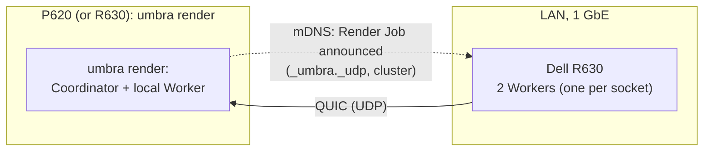

# 7. Deployment View

## 7.1 Infrastructure

Two target machines on one LAN, inventoried on 2026-11-06 ([Hardware inventory of target machines](https://github.com/sergioffpc/umbra/issues/19)).

|                 | Lenovo P620                                                                                 | Dell PowerEdge R630                                                    |
| --------------- | ------------------------------------------------------------------------------------------- | ---------------------------------------------------------------------- |
| CPU             | AMD Threadripper PRO 3975WX (Zen 2)                                                         | 2 × Intel Xeon E5-2690 v4 (Broadwell-EP), 2.6 GHz base / 3.5 GHz turbo |
| Architecture    | `x86_64-unknown-linux-gnu`                                                                  | `x86_64-unknown-linux-gnu`                                             |
| Cores / threads | 32 / 64 (SMT on)                                                                            | 28 / 56 (14 / 28 per socket, SMT on)                                   |
| SIMD            | AVX2, FMA, F16C, BMI1/2; **no AVX-512**                                                     | AVX2, FMA, F16C, BMI1/2; **no AVX-512**                                |
| L1d / L2        | 32 KiB / 512 KiB per core                                                                   | 32 KiB / 256 KiB per core                                              |
| L3 / LLC        | 128 MiB in 8 × 16 MiB slices (one per CCX of 4 cores)                                       | 2 × 35 MiB (one per socket)                                            |
| Cache line      | 64 B                                                                                        | 64 B                                                                   |
| NUMA            | 1 node (NPS1, kept fixed), but L3 split over 8 CCXs                                         | **2 nodes** (one per socket, 128 GiB each)                             |
| RAM             | 128 GiB DDR4-3200, 8 channels                                                               | 256 GiB DDR4-2133, 8 × 32 GB 4R (4 channels per socket)                |
| OS              | Ubuntu 26.10, kernel 7.3                                                                    | Debian 13, kernel 6.12                                                 |
| Network         | 1 GbE (AQC107 10G NIC, link at 1G)                                                          | 1 GbE (82599ES 10G SFP+ NIC, link at 1G)                               |
| Notes           | GPU (RTX 5070 Ti): on the roadmap ([ADR 0024](../adr/0024-a-gpu-backend-on-the-roadmap.md)) | Host firewall (nftables) admits only SSH from the LAN                  |

**Network target: 1 GbE.** Measured P620 ↔ R630 with `iperf3`: ~941 Mb/s in each direction (one stream or four), RTT ~0.25 ms. Both NICs can do 10 GbE, but Umbra is designed for 1 GbE.

Consequences for later decisions:

- **SIMD baseline**: no target machine has AVX-512, so kernels are written for `x86-64-v3` (AVX2 + FMA); an AVX-512 path has no machine to run or benchmark on. Release binaries target exactly that baseline (section 7.2).
- **NUMA**: the R630 is the only multi-node machine, so it runs one Worker per node ([ADR 0017](../adr/0017-one-worker-per-numa-node.md)); the P620's L3 is split over 8 CCXs, so cache locality matters there too (section 8.14).
- **SMT**: both machines run two threads per core.
- **Bandwidth**: ~117 MB/s per link to the Coordinator bounds Scene replication and Work Result traffic.
- **Firewall**: Workers only open outgoing QUIC connections, so only the Coordinator's UDP port needs opening, on every machine that runs a Coordinator. Discovery needs mDNS (UDP 5353) on every machine, so the R630's nftables, which admits only SSH, needs a rule for it (§7.3).

## 7.2 Builds

Every machine runs the same release binary, built for `x86-64-v3` ([ADR 0025](../adr/0025-one-x86-64-v3-release-image.md)), and every machine in a Render Job runs the same commit ([ADR 0012](../adr/0012-per-cpu-binaries-locked-to-one-commit.md)). Development builds use the host's own CPU, and different builds are not promised to give the same bits, only statistically equal images ([ADR 0022](../adr/0022-determinism-on-one-machine-statistical-equality-across-machines.md)).

| Build       | Target CPU  | Artifact                                     |
| ----------- | ----------- | -------------------------------------------- |
| Release     | `x86-64-v3` | `ghcr.io/sergioffpc/umbra:X.Y.Z` (container) |
| Development | `native`    | `cargo build` on each host                   |

- **Releases**: a `vX.Y.Z` tag on `main` makes CI build the [`Dockerfile`](../../Dockerfile) once and publish one image, with the rest of the pipeline as described in [ADR 0005](../adr/0005-chiseled-release-container-image.md). There is no `X.Y` or `latest` tag.
- **Development**: every host builds the ref under test itself, with the toolchain pinned in `rust-toolchain.toml` and `target-cpu=native` from `.cargo/config.toml`. There is no cross-compilation.
- **Build Identity**: every binary embeds its git commit, whether its tree was dirty, and its target CPU. A container build receives the commit as a build argument.

## 7.3 Deployment and launch

- **Workers run permanently** ([ADR 0021](../adr/0021-plug-and-play-workers-in-a-named-cluster.md)). The operator starts one Worker per NUMA node on each host and leaves it running ([ADR 0017](../adr/0017-one-worker-per-numa-node.md)). For a release, that means running the host's CPU variant with `docker run -d --restart unless-stopped --network host`. For a development build, it means running `target/release/umbra worker` from a checkout of the ref under test. Each Worker is bound to its NUMA node with `numactl --cpunodebind=N --membind=N`, or in a container with `--cpuset-cpus` and `--cpuset-mems`, so the R630 runs two. The commands are in the [README](../../README.md#rendering-on-several-machines). An idle Worker holds no Scene.
- **Cluster.** Every Coordinator and Worker takes a Cluster Name from `--cluster` or `UMBRA_CLUSTER`, and uses `default` when neither is set. A Coordinator works only with Workers of its own Cluster, so separate Clusters can share the LAN, for example to benchmark one machine alone.
- **The Coordinator runs on the operator's machine.** That is wherever the operator runs `umbra render`. The Coordinator and its optional in-process local Worker ([ADR 0009](../adr/0009-pull-based-pass-major-scheduling.md)) run in that process. The Scene File is read and the image and Render Job Report are written on that machine, so nothing is copied to or from it. That machine is the P620, the operator's workstation and the strongest machine, or the R630 ([ADR 0023](../adr/0023-x86-64-only.md)).
- **Start-up order.** The Coordinator parses the Scene File and builds the Scene, opens its UDP port, and only then announces the Render Job by DNS-SD. On Diagnostics it exits before announcing anything. Idle Workers of its Cluster join as soon as they see the announcement, and Workers that start later join the Render Job in progress. Discovery is described in [§8.13](08-crosscutting-concepts.md#813-wire-protocol).
- **Failures.** A Worker that loses its Render Job abnormally rejoins it after a backoff, and the Coordinator refuses a Worker Slot after three consecutive failures (§8.13). A Worker process that dies is restarted by its supervisor: Docker's restart policy for releases, the operator for development builds.
- **Ctrl-C stops the Render Job, not the Workers.** In the terminal running `umbra render`, Ctrl-C makes the Coordinator withdraw its announcement, cancel the Render Job, write the Render Job Report without an image, and exit 130. The Workers return to idle. The scenario is in [§6.6](06-runtime-view.md#66-ctrl-c-cancellation) and the close and exit codes in [§8.13](08-crosscutting-concepts.md#813-wire-protocol). This was decided in [Closing connections: dead Workers and cancellation](https://github.com/sergioffpc/umbra/issues/60).
- **Version lockstep.** On connection, the Coordinator rejects any Worker whose Build Identity names a different commit. Dirty builds are rejected unless the Render Job runs with `--allow-dirty`, which the Render Job Report records. After changing commit, the operator rebuilds and restarts the Worker on every host, or pulls and restarts the release image. The Coordinator logs each refused Worker with its host and commit. The handshake is described in [§8.13](08-crosscutting-concepts.md#813-wire-protocol).
- **One-time host setup.** Each host needs Docker and rustup. Every machine admits mDNS, UDP 5353 from the LAN (nftables on the R630). Every machine an operator runs `umbra render` from also admits the Coordinator's QUIC port, UDP 7470.
