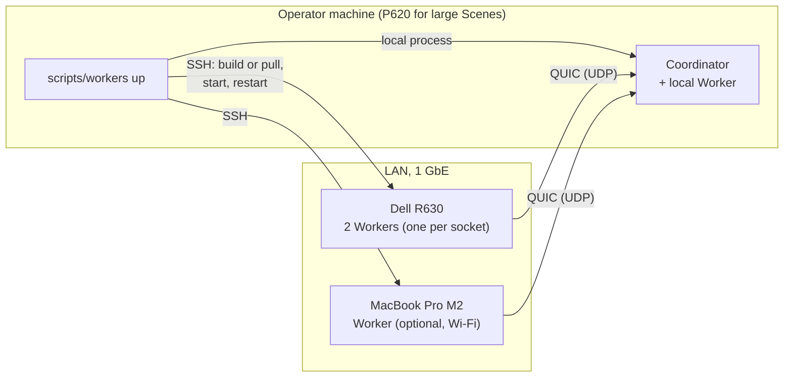

# 7. Deployment View

## 7.1 Infrastructure

Three machines on one LAN, inventoried on 2026-11-06 ([Hardware inventory of target machines](https://github.com/sergioffpc/umbra/issues/19)).

| | MacBook Pro M2 | Lenovo P620 | Dell PowerEdge R630 |
| --- | --- | --- | --- |
| CPU | Apple M2 Pro (`Mac14,10`) | AMD Threadripper PRO 3975WX (Zen 2) | 2 × Intel Xeon E5-2690 v4 (Broadwell-EP), 2.6 GHz base / 3.5 GHz turbo |
| Architecture | `aarch64-apple-darwin` | `x86_64-unknown-linux-gnu` | `x86_64-unknown-linux-gnu` |
| Cores / threads | 12 / 12 (8 P + 4 E, no SMT) | 32 / 64 (SMT on) | 28 / 56 (14 / 28 per socket, SMT on) |
| SIMD | NEON (AdvSIMD), FP16, DotProd, I8MM, BF16; no SVE | AVX2, FMA, F16C, BMI1/2; **no AVX-512** | AVX2, FMA, F16C, BMI1/2; **no AVX-512** |
| L1d / L2 | P: 128 KiB / 16 MiB shared by 4 cores; E: 64 KiB / 4 MiB shared by 4 | 32 KiB / 512 KiB per core | 32 KiB / 256 KiB per core |
| L3 / LLC | System Level Cache (not reported) | 128 MiB in 8 × 16 MiB slices (one per CCX of 4 cores) | 2 × 35 MiB (one per socket) |
| Cache line | **128 B** | 64 B | 64 B |
| NUMA | 1 node | 1 node (NPS1, kept fixed), but L3 split over 8 CCXs | **2 nodes** (one per socket, 128 GiB each) |
| RAM | 32 GB LPDDR5 | 128 GiB DDR4-3200, 8 channels | 256 GiB DDR4-2133, 8 × 32 GB 4R (4 channels per socket) |
| OS | macOS 26.6 | Ubuntu 26.10, kernel 7.3 | Debian 13, kernel 6.12 |
| Network | Wi-Fi | 1 GbE (AQC107 10G NIC, link at 1G) | 1 GbE (82599ES 10G SFP+ NIC, link at 1G) |
| Notes | 16 KiB pages | GPU (RTX 5070 Ti) unused: GPU is out of scope | Host firewall (nftables) admits only SSH from the LAN |

**Network target: 1 GbE.** Measured P620 ↔ R630 with `iperf3`: ~941 Mb/s in each direction (one stream or four), RTT ~0.25 ms. Both NICs can do 10 GbE, but Umbra is designed for 1 GbE. The MacBook joins over Wi-Fi.

Consequences for later decisions:

- **SIMD baseline**: no target machine has AVX-512, so x86 kernels are written for `x86-64-v3` (AVX2 + FMA) and arm64 kernels for NEON; an AVX-512 path has no machine to run or benchmark on. Binaries are still compiled per CPU (section 7.2).
- **NUMA**: the R630 is the only multi-node machine, so it runs one Worker per node ([ADR 0017](../adr/0017-one-worker-per-numa-node.md)); the P620's L3 is split over 8 CCXs, so cache locality matters there too (section 8.14).
- **Cache-line padding**: per-thread data must be padded to 128 B to avoid false sharing on Apple silicon (64 B suffices on x86).
- **Heterogeneous threads**: the M2's P and E cores differ in speed; x86 machines use SMT.
- **Bandwidth**: ~117 MB/s per link to the Coordinator bounds Scene replication and Work Result traffic.
- **Firewall**: Workers only open outgoing connections, so only the Coordinator's UDP port needs opening, on every machine that runs a Coordinator (§7.3). The R630's nftables admits only SSH.

## 7.2 Build per machine

Each machine runs a binary compiled for its own CPU ([ADR 0012](../adr/0012-per-cpu-binaries-locked-to-one-commit.md)). Different targets never change results ([ADR 0002](../adr/0002-bit-identical-results-across-architectures.md)).

| Machine | Target CPU | Release artifact | Development build |
| --- | --- | --- | --- |
| Lenovo P620 | `znver2` | `ghcr.io/sergioffpc/umbra:X.Y.Z-znver2` (container) | `cargo build` on the host |
| Dell R630 | `broadwell` | `ghcr.io/sergioffpc/umbra:X.Y.Z-broadwell` (container) | `cargo build` on the host |
| MacBook Pro M2 | `apple-m2` | `cargo build --release` from the tag, native | `cargo build` on the host |

- **Releases**: a `vX.Y.Z` tag on `main` makes CI build the [`Dockerfile`](../../Dockerfile) once per Linux CPU (`TARGET_CPU` build argument) and publish one image per CPU, with the rest of the pipeline as described in [ADR 0005](../adr/0005-chiseled-release-container-image.md). There is no `latest` or generic image. This is the target of ADR 0012: until TD-1 (§11.2) is repaid, the pipeline still publishes one `x86-64-v3` image.
- **Development**: every host builds the ref under test itself, with the toolchain pinned in `rust-toolchain.toml` and `target-cpu=native` from `.cargo/config.toml`. There is no cross-compilation.
- **Build Identity**: every binary embeds its git commit, whether its tree was dirty, and its target CPU. A container build receives the commit as a build argument.

## 7.3 Deployment and launch

- **The Coordinator runs on the operator's machine** ([ADR 0018](../adr/0018-sessions-launched-from-the-operators-machine.md)). The operator's machine is wherever `scripts/workers up` runs; the Coordinator and its optional in-process local Worker ([ADR 0009](../adr/0009-pull-based-pass-major-scheduling.md)) run there as local processes. The Scene File is read and the image and Render Job Report are written on that machine, so nothing is copied to or from it. For large Scenes the operator logs into the P620 and runs the script there, because it is the strongest machine and is wired; from the MacBook every Scene transfer crosses Wi-Fi.
- **Workers are started per session from the operator's machine.** `scripts/workers up --ref <git-ref>` builds that ref on every host, the local one included, with `cargo`. `scripts/workers up --version X.Y.Z` pulls the host's CPU variant and runs it with `docker run --network host`. The script starts one Worker per NUMA node, each under `numactl --cpunodebind=N --membind=N` ([ADR 0017](../adr/0017-one-worker-per-numa-node.md)), so the R630 runs two. The host list, which records each host's SSH name, target CPU and NUMA node count, belongs to the operator. A Worker exits when it loses the Coordinator, and nothing keeps running between sessions.
- **Start-up order.** Build or pull on every host in parallel, aborting on any failure. Start the Coordinator, which parses the Scene File and builds the Scene before it opens its UDP port, and exits on Diagnostics before any Worker exists. Wait for its readiness line on stderr. Start the Workers over SSH, in the foreground, with `--coordinator <operator address as seen by the host, from $SSH_CLIENT>:<port> --session <id>`, and stream their logs. A Worker does not retry its initial connection.
- **Automatic restart.** While the Coordinator runs, the script restarts a Worker Slot whose Worker or SSH session ends abnormally, at most three consecutive times, and never after a normal end, a cancellation or a refusal. The exit statuses it acts on, the backoff and the reset rule are in [§8.13](08-crosscutting-concepts.md#813-wire-protocol) and [ADR 0018](../adr/0018-sessions-launched-from-the-operators-machine.md). Restarts reuse the built binary. Hosts outside the starting host list cannot join a running Session.
- **Ctrl-C stops the Session.** In the terminal running `scripts/workers up`, Ctrl-C reaches only the Coordinator, which cancels the Render Job and writes the Render Job Report without an image. The Workers exit and are not restarted, and the script exits with the Coordinator's code, 130. Scenario in [§6.6](06-runtime-view.md#66-ctrl-c-cancellation), close and exit codes in [§8.13](08-crosscutting-concepts.md#813-wire-protocol); decided in [Closing connections: dead Workers and cancellation](https://github.com/sergioffpc/umbra/issues/60).
- **Version lockstep.** On connection, the Coordinator rejects any Worker whose Build Identity names a different commit. Dirty builds are rejected unless the Render Job runs with `--allow-dirty`, which the Render Job Report records. Workers must also present the Session identifier the launch script generates. The handshake is in [§8.13](08-crosscutting-concepts.md#813-wire-protocol).
- **One-time host setup.** Each Linux host needs Docker and rustup; the MacBook needs rustup. The Coordinator's QUIC UDP port is opened once in the firewall of every machine an operator runs Sessions from (the macOS Application Firewall on the MacBook, nftables on the R630).
