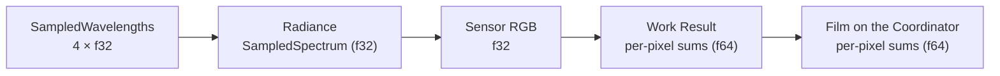
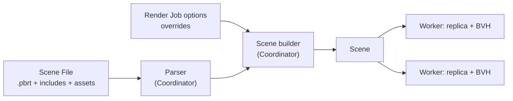
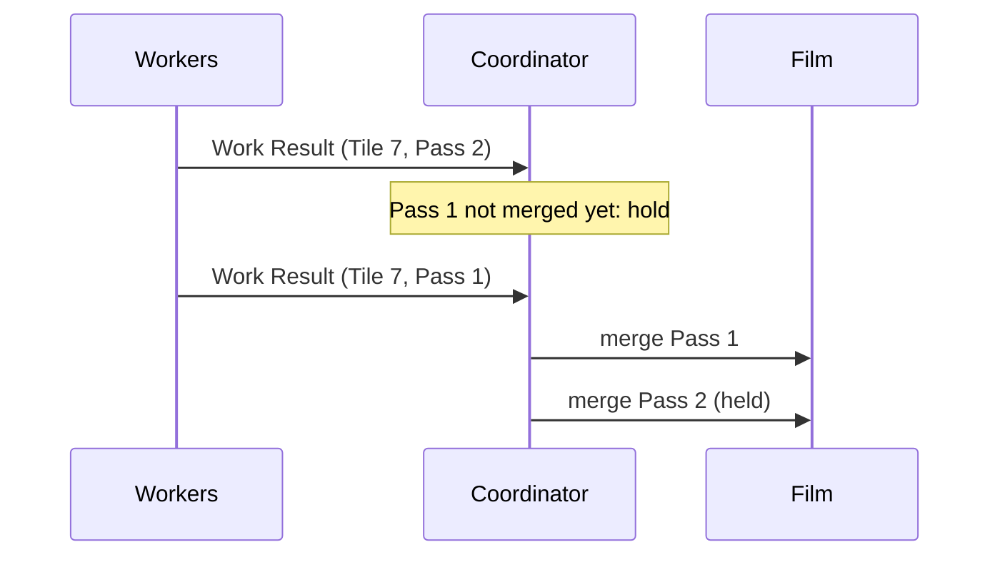
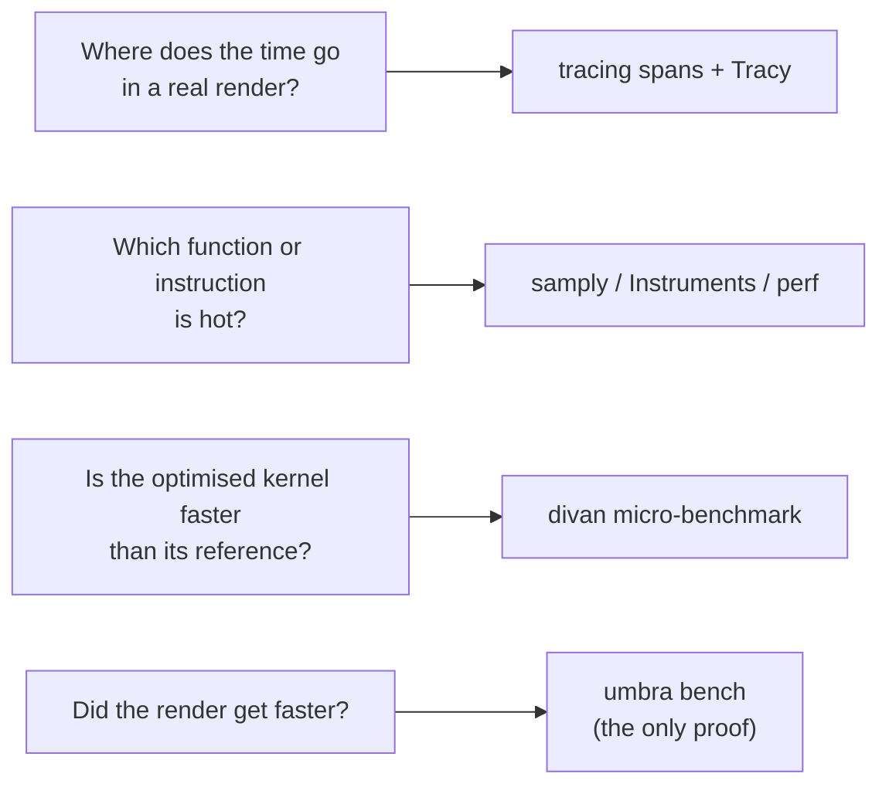
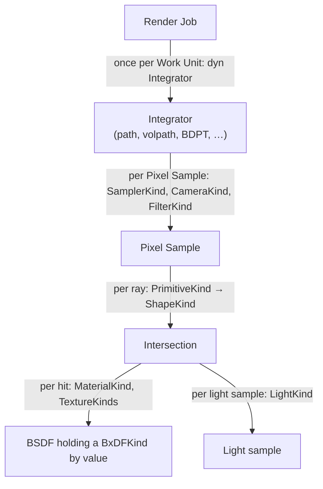
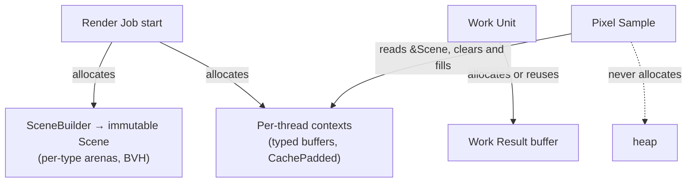
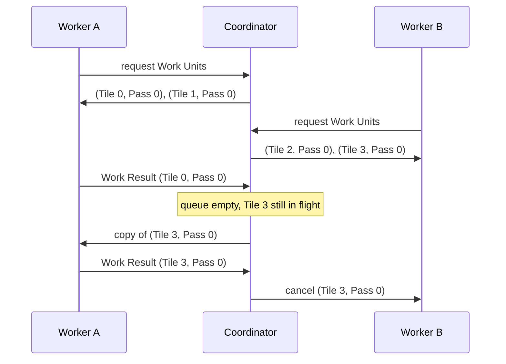
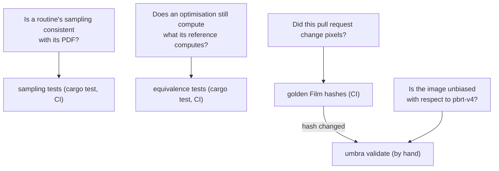

# 8. Crosscutting Concepts

## 8.1 Numerics and spectral representation

Umbra follows pbrt-v4's numeric model ([ADR 0001](../adr/0001-numeric-model.md)) and requires bit-identical results on every Worker architecture ([ADR 0002](../adr/0002-bit-identical-results-across-architectures.md)).

| Concern | Rule |
| --- | --- |
| Precision | `f32` throughout the rendering core; no `f64` option. `f64` only for the per-pixel sums in Work Results and the Film. |
| Spectrum | Spectral only. `SampledSpectrum` / `SampledWavelengths` with a constant `N_SPECTRUM_SAMPLES = 4`, backed by `Vec4`. Visible-wavelength sampling as in pbrt-v4. |
| Ray robustness | pbrt-v4 error bounds: `Interval`, `Point3fi`, a `pError` for every shape, `offset_ray_origin`, `spawn_ray_to`, `1 + 2γ(3)` in ray-box tests (also in SIMD). |
| RGB input | Jakob–Hanika RGB-to-spectrum tables generated in `build.rs` with `libm`; sRGB first, more colour spaces when a milestone needs them. Hash checked in CI. |
| Spectral data | pbrt-v4's CIE matching functions and named spectra as Rust `const` arrays (Apache-2.0, attributed in `NOTICE`). |
| Film | Pixel Samples are converted to sensor RGB on the Worker. Work Results carry `f64` weighted-RGB and weight sums per pixel. The Film sums in `f64`. Filter importance sampling only, so no cross-pixel splatting. |
| Math | A core `math` module ports pbrt-v4's helpers (`difference_of_products`, `sum_of_products`, `evaluate_polynomial`, compensated sums, `safe_sqrt`, `safe_asin`, `erf_inv`, …). Explicit `mul_add` where pbrt uses FMA, with hardware FMA required. Transcendentals from `libm`. No fast-math. |
| SIMD | No approximate `rcp`/`rsqrt`. Kernels are bit-identical to their scalar reference, which is the test oracle. Explicit NaN semantics for `min`/`max`. |
| Floating-point state | IEEE defaults; never flush-to-zero or denormals-are-zero. |
| NaN / Inf | `debug_assert!` wherever pbrt-v4 has a `DCHECK`. |

The flow of numeric precision for one Pixel Sample:



## 8.2 Scene input

Umbra reads pbrt-v4 Scene Files only, validates them strictly and parses them once on the Coordinator ([ADR 0003](../adr/0003-pbrt-v4-scene-files-parsed-on-the-coordinator.md)).

| Concern | Rule |
| --- | --- |
| Format | pbrt-v4 `.pbrt`, unextended, at a pinned `mmp/pbrt-v4` commit. Each milestone declares the supported subset. No pbrt-v3, no custom format. |
| Validation | Any unsupported directive, type or parameter rejects the Render Job before any Work Unit is assigned. All uses are reported, each with `file:line:column`. Recognised but unused parameters produce a warning. |
| Parser | `nom` + `nom_locate` for the lexical layer and directives, behind a `ParserTarget`-style interface. Graphics state and Scene builder follow pbrt-v4. |
| Replication | The Coordinator builds a format-independent Scene, with assets referenced by content hash, and replicates it to every Worker. Workers build their own acceleration structures. |
| Render Job options | Tile size, Pixel Samples per Pass and Workers are given at submission, never in the Scene File. pbrt-v4-style overrides (`--spp`, `--seed`, …) take precedence and are applied when the Scene is built. |



## 8.3 Determinism

For a fixed Scene, seed and Render Job options, the final Film is bit-identical regardless of Workers, threads, arrival order or failures ([ADR 0004](../adr/0004-deterministic-film-for-a-fixed-render-job.md)).

| Concern | Rule |
| --- | --- |
| Scope | Fixed: Scene, seed, Tile size, Pixel Samples per Pass. Free: number of Workers, Worker and thread per Work Unit, arrival order, failures and reassignments. Changing the decomposition may change the last bit. |
| Sampling | A Pixel Sample is a pure function of `(Scene, seed, pixel, sample index)`. pbrt-v4 samplers, hashes (`MixBits`, `MurmurHash64A`), PCG32 and Sobol tables are ported faithfully. No randomness outside the sampler on the render path, enforced by lint. Default seed 0, `--seed` overrides it. |
| Work Result order | Each pixel sums its Pixel Samples in ascending sample index. Threads split a Work Unit by pixel. |
| Film order | Per Tile, Work Results are merged in Pass order. Early arrivals wait on the Coordinator. |
| Splats | Cross-Tile contributions go into a separate splat accumulator, merged in the total order (Pass, Tile index). MLT and SPPM designs must preserve the guarantee. |
| BVH | A pure function of the Scene: stable SAH partitioning, explicit tie-breaks, parallelism only over disjoint subtrees joined in a fixed order. |
| Termination | Every Render Job renders all its Passes. No time budget, no adaptive sampling. Cancelling produces no image. |
| Verification | Film-hash tests in CI on arm64 and x86-64. Invariance tests (thread count, Work Unit order, simulated Worker failure). A 64-bit hash per Work Result, compared when duplicates arrive. An opt-in `verify` Render Job option. |

Merge order for one Tile on the Coordinator:



## 8.4 Performance measurement

How performance claims are measured and guarded ([Benchmark and profiling infrastructure](https://github.com/sergioffpc/umbra/issues/14)). It backs the rule that an aggressive optimisation needs a benchmark showing the gain.

| Concern | Rule |
| --- | --- |
| Proof of a gain | An optimisation is accepted only on an end-to-end gain: one Worker, no network, on the Reference Scenes. Micro-benchmarks help to iterate and to locate a gain, but never justify one on their own. |
| Metrics | The main metric is Pixel Samples per second in the render phase (wall-clock, all threads of the Worker). Each other phase is timed on its own: parse, Scene build, BVH build. They are the comparable fields of the Render Job Report written at the end of every Render Job (§8.10). |
| Reference Scenes | Taken only from `mmp/pbrt-v4-scenes` at a pinned commit (§8.11), downloaded and never vendored. Each milestone adds the ones it can render, and none is ever removed. Each entry fixes resolution, Pixel Samples per pixel, seed and Tile size for benchmarking, sized for 10–60 s per machine, and separately for validation (§8.11). |
| Where | Measured by hand on the three target machines (§7.1) with `umbra bench`, and the report is attached to the PR. Arm64 (M2) is required for NEON changes, at least one x86-64 machine for AVX2 changes, and the R630 for any threading or memory change (NUMA). Shared CI runners only smoke-test: `cargo bench --no-run` and one small Scene rendered to completion, with no numbers compared. |
| No remote triggers | No self-hosted runners and no GitHub-triggered execution on the target machines. Every measurement on them is started by hand. |
| Noise | Baseline and candidate commits run interleaved (A, B, A, B, …) on the same idle machine: 1 discarded warm-up, then 5 runs each. A gain counts if the 95 % confidence interval of the difference excludes zero and the median gain is ≥ 2 %. The report records the CPU model, OS, commit, build flags, and the governor and frequency when available. |
| Regressions | Every milestone ends with a benchmark measurement issue, run by hand on all three machines against the previous milestone. `umbra bench` reads the Render Job Report of every run and commits the aggregated result to `docs/benchmarks/<milestone>/<machine>.json`. A regression above 2 % in a comparable field blocks closing the milestone until it is fixed or explained. Informative fields are carried along (median of the runs) to explain a difference and never block. `umbra bench` refuses to compare reports of different schema major versions. |
| Distribution | From the milestone that introduces distribution, the measurement issue also records three numbers. Scaling efficiency is the cluster's Pixel Samples per second divided by the sum of each Worker's standalone rate. The other two are Scene replication time and Worker idle time (no Work Unit). A drop of more than 2 percentage points in efficiency, or an efficiency below the target of section 10 (QS-7), blocks the milestone. |
| pbrt-v4 reference | The measurement issue also renders each Reference Scene with pbrt-v4 (CPU, pinned commit) on the same machine, at the same resolution, Pixel Samples per pixel and thread count. The Umbra / pbrt-v4 speed ratio is recorded on every machine and blocks the milestone only below the targets of section 10 (QS-5: geometric mean ≥ 0.5 each milestone, ≥ 1.0 at the last). The same renders feed the correctness target QS-1. |
| Micro-benchmarks | `divan` in `benches/`. A readable reference and its optimised version are benchmarked side by side in one generic bench, and `AllocProfiler` checks the allocation-free core. |
| Instrumentation | Coarse `tracing` spans only: Render Job, each phase, Work Unit, Work Result send and merge. Never inside the rendering core, never per Pixel Sample or per ray. Tracy via `tracing-tracy` behind the Cargo feature `tracy`, off by default. |
| Profilers | Sampling profilers on the `profiling` build profile: samply on all three machines, plus Instruments on macOS and `perf` (hardware counters) on Linux. |

What answers which question:



## 8.5 Polymorphism

How pbrt-v4's interfaces are dispatched in Rust ([ADR 0006](../adr/0006-closed-enum-dispatch-for-rendering-interfaces.md)). The rule follows how often a call happens: closed enums on the per-ray and per-Pixel-Sample path, `dyn Trait` only at coarse seams.

| Concern | Rule |
| --- | --- |
| Hot-path interfaces | Shape, Primitive (acceleration structure included), Material, BxDF, Light, FloatTexture, SpectrumTexture, Medium, PhaseFunction, Sampler, Camera and Filter dispatch through a closed `enum` and `match`. Never `dyn`. |
| Shape of an interface | A trait with the book's name is the contract (`trait Shape`). Concrete types keep pbrt-v4's names (`Sphere`, `DiffuseBxDF`) and implement it. The enum is `<Interface>Kind` (`ShapeKind`) and implements the trait with a hand-written `match` per method. pbrt-v4's `LightType` keeps its name, distinct from `LightKind`. |
| Exhaustive matches | No `_` arm in a `match` on a `*Kind` enum. Enforced crate-wide by lint (§8.6). |
| Fixed per Render Job | Sampler, Camera and Filter are still matched per call. Hoisting the `match` into a monomorphised loop is an aggressive optimisation (benchmark, isolated contract, per-call version as reference). |
| Generics | Free when they are not interface dispatch (`Vector3<T>`, `Bounds3<T>`). |
| `dyn Trait` | Only for code called at most once per Work Unit or outside rendering: `dyn Integrator`, network transport, image writers, `ParserTarget`, telemetry. |
| BxDF lifetime | Returned by value as `BxDFKind` and held on the stack inside the `BSDF`. `size_of::<BxDFKind>() <= 256` is asserted at compile time. `MixMaterial` picks one material stochastically, so there is no mixed BxDF. |
| Textures | `FloatTextureKind` and `SpectrumTextureKind`. No `TextureEvaluator` until a wavefront driver needs it. |

Where each dispatch mechanism sits, by call frequency:



## 8.6 Unsafe code and lints

What the compiler and clippy enforce beyond style ([Unsafe policy and lint configuration](https://github.com/sergioffpc/umbra/issues/21)). The full lint set lives in `[lints]` in `Cargo.toml` and in `clippy.toml`. `CONTRIBUTING.md` explains it for contributors. Every warning is an error in CI.

| Concern | Rule |
| --- | --- |
| `unsafe` | Denied crate-wide. An exception is an aggressive optimisation (benchmark, safe contract, tested safe reference) opened with `#[expect(unsafe_code, reason)]` on the narrowest item ([ADR 0007](../adr/0007-unsafe-code-as-an-aggressive-optimisation.md)). No module is unsafe by default. |
| `unsafe` documentation | One unsafe operation per block, a `// SAFETY:` comment on every block, a `# Safety` section on every `unsafe fn`, and no `SAFETY` comments on safe code. |
| `unsafe` verification | Tests of every `unsafe` item run under Miri in CI (nightly pinned for that job), or under AddressSanitizer on Linux where Miri cannot execute the code. The job lands with the first exception. |
| Exhaustive dispatch | No `_` arm in a `match` on an enum (`wildcard_enum_match_arm`, `match_wildcard_for_single_variants`), so a new `*Kind` variant breaks the build wherever it is not handled (§8.5). On a `#[non_exhaustive]` foreign enum, a `_` arm is allowed after listing the known variants. |
| Bit-identical numerics | `disallowed-methods` bans `std`'s transcendental `f32`/`f64` methods (platform libm), approximate reciprocal intrinsics (`rcp`, `rsqrt`, `vrecpe`, `vrsqrte`, `wide`'s `recip`) and FP control-register writes (flush-to-zero, denormals-are-zero). Tests are not exempt ([ADR 0002](../adr/0002-bit-identical-results-across-architectures.md)). |
| Output | No `print!`/`eprint!` outside tests: output goes through `tracing` and the Render Job Report (§8.10). |
| Silencing | `#[expect(lint, reason = "...")]` on the narrowest item. `#[allow]` and reasonless attributes are rejected. |

## 8.7 Memory and allocation

How the Scene is stored and where rendering may allocate ([ADR 0008](../adr/0008-index-handle-arenas-and-allocation-free-rendering.md)). Objects live in per-type arenas and refer to one another by typed `u32` handles. Nothing on the per-Pixel-Sample path allocates.

| Concern | Rule |
| --- | --- |
| Scene storage | One `Vec<T>` arena per concrete type. References are typed `u32` handles (`MeshId`, `MaterialId`, `Handle<T>`), never `&T`, `Box`, `Arc` or raw `usize`. Validation rejects more than `u32::MAX` objects of one type. |
| `*Kind` size | Scene-resident `*Kind` enums are tag plus handle(s), with `size_of <= 16` asserted at compile time. `ShapeKind::Triangle { mesh, index }` is inline. `BxDFKind` is by value (≤ 256 B, §8.5). `SamplerKind`, `CameraKind` and `FilterKind` are by value. Inline payloads are an aggressive optimisation. |
| Scene lifetime | `SceneBuilder` mints handles and freezes into an immutable `Scene` (BVH built). Threads share `&Scene`, with no `Arc`, locks or global mutable state. Dropped at the end of the Render Job. |
| Per-thread memory | A per-thread context of typed buffers (BDPT/MLT vertices, …) sized at Render Job start and cleared between Pixel Samples. No `ScratchBuffer`. |
| Allocation boundary | Allowed per Render Job, per Work Unit (Work Result buffer) and outside rendering. Never per Pixel Sample, except while recording a Pixel Trace. A counting-allocator test (N vs 2N Pixel Samples) enforces it for every integrator. |
| Per-sample contract | `&Scene` (`get(handle)`, slices), `&mut` thread context and `Copy` values. No `alloc` dependency. Bounds-checked indexing, `get_unchecked` only under §8.6. |
| Alignment | `CachePadded` (128 B) for per-thread mutable data adjacent to other threads'. Natural alignment elsewhere. A cache-line BVH node layout is an aggressive optimisation. |
| NUMA | No NUMA-local allocation yet. The Scene is pointer-free and `Clone`, so a replica per NUMA node (R630) can be added with a benchmark. |
| Global allocator | System allocator. Replacing it is an aggressive optimisation measured on the scene-build phase. |

Who allocates what, and when:



## 8.8 Work scheduling

How a Render Job is split and scheduled across Workers and cores ([ADR 0009](../adr/0009-pull-based-pass-major-scheduling.md), [ADR 0010](../adr/0010-quic-transport-between-coordinator-and-workers.md)).

| Concern | Rule |
| --- | --- |
| Decomposition | Square Tiles, 32 × 32 by default; Passes of 64 Pixel Samples by default. Both are Render Job options, never derived from the cluster. |
| Assignment | Workers pull Work Units, about two in flight per eight threads. Pass-major order, raster Tile order within a Pass. Pass p of a Tile waits until Pass p − 2 of that Tile is merged. |
| Inside a Worker | One rayon pool. Work Units in flight run concurrently, each splitting its rows with `par_iter`. No thread pinning by default. |
| Failure detection | Connection closed, or 5 s without a heartbeat (sent every second). Both are Coordinator options. No per-Work-Unit timeout. |
| Reassignment | A dead Worker's Work Units go to the front of the queue. A reconnecting Worker joins as new. The first Work Result per Work Unit is accepted; later ones are hash-compared and discarded. With no Workers, the Render Job waits. |
| Tail | Once the queue is empty, the oldest Work Unit in flight is copied to a free Worker, at most once. The first Work Result wins, the other is cancelled. |
| Transport | QUIC (`quinn`) to remote Workers; an in-memory transport to the Coordinator's optional local Worker. |



## 8.9 Per-pixel debugging

How to see how a pixel was computed ([ADR 0011](../adr/0011-pixel-traces-by-deterministic-re-execution.md), [Per-pixel debugging](https://github.com/sergioffpc/umbra/issues/24)). A Render Job never records a Pixel Trace. `umbra trace` re-runs the chosen Pixel Samples later, in one local process, with recording switched on.

| Concern | Rule |
| --- | --- |
| Production | `umbra trace final.exr --pixel x,y` re-runs Pixel Samples locally. It parses the Scene File and builds the BVH itself, with no Coordinator and no Workers. The protocol and Work Results carry no traces. |
| Addressing | pbrt-v4 raster convention: origin at the top left, full Film resolution even with a crop window. `--pixel x,y`, or `--pixels x0,x1,y0,y1` (a small rectangle, capped). `--sample i` selects one Pixel Sample; without it, every Pixel Sample of the pixel is traced. |
| Reproduction | The final image carries a Reproduction Record in its metadata: the Scene File path, a content hash of the Scene File with its includes and assets, the seed, every Render Job option and the Umbra commit. `umbra trace` refuses to run on a mismatch and names what differs. `--force` runs anyway, with a warning. |
| Detail levels | Path, the default: camera sample, sampled wavelengths, primary ray. Then, per vertex: hit point, normal, Shape, Material, BSDF, BSDF sample (`f`, `pdf`, flags), light sample (Light, selection probability, `Li`, `pdf`, shadow-ray outcome), MIS weights, throughput before and after, Russian roulette, and the contribution added to `L`. Then the termination reason and the sampler dimension consumed by each request. Traversal (`--detail traversal`) adds, per ray, the BVH nodes visited and the primitives tested with their hit distances. |
| Film side | Each Pixel Sample ends with the filter offset and weight, the sensor RGB and the value after `maxcomponentvalue` clamping. The trace ends with the pixel summary: the weighted sum of the traced Pixel Samples. |
| Mechanism | Integrators and traversal take `R: Recorder` (`no_std` core). `NoRecorder` is zero-sized and compiled away; `TraceRecorder` lives outside the core and may allocate (§8.7). Event arguments are values already computed. |
| Oracle | A test checks that radiance and the pixel summary are bit-identical with `NoRecorder` and `TraceRecorder`, and match the Work Result. |
| Text output | An indented tree per Pixel Sample on stdout, written through `io::Write` (not `print!`, §8.6). Each `f32` is printed in its shortest round-trip form, so two traces compare exactly with `diff`. No JSON. |
| 3D output | `--scene-export trace.glb` writes glTF that Blender opens natively. It contains the Scene as resolved by Umbra, tessellated for display only, together with the traced paths and the shadow rays, unoccluded and occluded in separate materials. At traversal level it also contains the wireframe boxes of the visited BVH nodes, one collection per ray, with hit and missed nodes in separate materials and the tested primitives highlighted. Scene and paths share one world space, so they always line up. |
| Anomalous Pixel Samples | A Pixel Sample with NaN, infinite or negative radiance is discarded, as in pbrt-v4. The Work Result lists the first 16 per Work Unit as (pixel, sample index, kind), plus a total count. At the end of the Render Job the Coordinator logs them in deterministic order, as ready-to-run `umbra trace` commands. |
| Integrators | Tracing is an acceptance criterion of every integrator. volpath adds medium events; BDPT adds both subpaths and each `(s, t)` strategy with its MIS weight. Splats that other Pixel Samples send to the inspected pixel do not appear in its trace. MLT and SPPM are decided with their work decomposition. |

From a suspicious pixel to its trace:

```mermaid
flowchart LR
    R["Render Job"] --> I["final.exr<br/>(with Reproduction Record)"]
    R --> G["Coordinator log:<br/>Anomalous Pixel Samples<br/>as umbra trace commands"]
    I --> V["image viewer<br/>(pixel coordinates)"]
    V --> T["umbra trace final.exr --pixel x,y"]
    G --> T
    T -->|"hash and version match"| E["re-run with TraceRecorder"]
    E --> X["text trace on stdout"]
    E --> B["trace.glb → Blender"]

## 8.10 Progress and telemetry

What a running Render Job shows and what it leaves behind ([Progress metrics](https://github.com/sergioffpc/umbra/issues/25)). There is no live view, so progress is text on the Coordinator's terminal, and the lasting record is the Render Job Report.

| Concern | Rule |
| --- | --- |
| Status line | On the Coordinator's stderr, redrawn in place when stderr is a TTY. One aggregate line: current Pass, Work Units merged / total, percentage of Pixel Samples (merged plus in flight), cluster Pixel Samples per second, elapsed time and ETA. Below it, one line per Worker: host, threads, Work Units in flight, its Pixel Samples per second, heartbeat age and state (`alive`, `stale`, `stalled`, `dead`). Without a TTY, the same content is an `info` event every ~10 s, one per Worker. |
| No endpoint | No HTTP, Prometheus or other metrics endpoint. One may be added later behind the telemetry seam (`dyn`, §8.5) without touching the rest. |
| Heartbeat progress | Every heartbeat carries, per Work Unit in flight, the cumulative count of Pixel Samples completed, and the Worker's busy threads / total threads. Cumulative counts tolerate lost heartbeats. The Coordinator derives every rate; Workers never send rates. |
| ETA | During Pass 0: remaining Pixel Samples over an exponential moving average (~10 s) of the cluster rate, shown as provisional (`~`). From Pass 1: the sum of the remaining Work Units' Tile costs over the recent cluster throughput. A Tile's cost is its render time, measured by the Worker, sent in the Work Result and normalised by that Worker's rate. The duration is metadata outside the Work Result content hash (ADR 0004). |
| Stalled Worker | A Worker that sends heartbeats but whose Pixel Sample count has not grown for 30 s (Coordinator option) is shown as `stalled` and logged as a `warn`. Nothing is reassigned: scheduling stays as in ADR 0009, and the speculative tail covers it at the end. |
| Ray statistics | pbrt-v4-style counters (rays by kind, intersection tests, BVH nodes visited, path lengths) only with the Cargo feature `stats`, off by default and compiled away when off. Plain integers in the per-thread context (§8.7): no atomics, no allocation, never shared. Summed per Work Unit, sent in the Work Result, aggregated in the Render Job Report. Never on the status line. They do not touch the Film. |
| Render Job Report | One JSON file per Render Job, written next to the final image (`<image>.report.json`, path is a Render Job option). Umbra's own schema, versioned `major.minor`, with a JSON Schema generated from the Rust types (`serde` + `schemars`) and committed. |
| Report content | Render Job: options, Film hash, phase times (parse, Scene build, BVH build, Scene replication, render, merge, image write), Pixel Samples per second, Anomalous Pixel Sample count (§8.9). Per Worker: host, CPU, threads, version, Work Units accepted, Pixel Samples, busy and idle time, mean thread occupancy, Scene replication and BVH build time. Scheduling: reassignments, speculative copies (won, lost, cancelled), duplicate Work Results discarded, hash mismatches, scaling efficiency when standalone rates are known. Per Tile: normalised cost. Scene and BVH: primitives per type, BVH nodes, maximum and mean depth, primitives per leaf (maximum, mean), total SAH cost, memory per arena and of the BVH, always present. `stats` counters when the feature is on. |
| Comparable fields | Only render-phase Pixel Samples per second and phase times are compared by `umbra bench` under the 2 % / 95 % CI rule (§8.4), plus scaling efficiency once the cluster is distributed. Everything else is informative. Changing the meaning of a comparable field bumps the schema major version. |
| Logs | `tracing` to stderr in the Coordinator and the Workers. Human-readable on a TTY, JSON lines otherwise; `--log-format=human\|json` forces one. `info` by default, with an `RUST_LOG`-style filter in `--log`. Workers have no status line: at `info` they log lifecycle events (joined, Scene received, BVH built, disconnected) and a summary of their Work Units in flight every ~10 s. |

Where each metric comes from and where it ends up:

```mermaid
flowchart LR
    W["Worker"] -->|"heartbeat, every 1 s:<br/>cumulative Pixel Samples,<br/>busy threads"| C["Coordinator"]
    W -->|"Work Result:<br/>render time, stats counters"| C
    C --> S["status line (stderr)<br/>aggregate + per Worker"]
    C --> L["tracing events<br/>(human or JSON lines)"]
    C --> R["Render Job Report<br/>(&lt;image&gt;.report.json)"]
    R --> B["umbra bench<br/>(comparable fields only)"]
```

## 8.11 Correctness validation

How Umbra proves it renders what pbrt-v4 renders ([ADR 0013](../adr/0013-statistical-validation-against-a-published-pbrt-v4-reference.md), [Correctness validation strategy](https://github.com/sergioffpc/umbra/issues/29)). Each layer catches what the one above cannot locate.

| Concern | Rule |
| --- | --- |
| Pinned reference | `mmp/pbrt-v4` at `b0bdf461ba5dd6504b70ebf0932acc0fe7aa744f`, `mmp/pbrt-v4-scenes` at `30cf4a0346ae5a80a2d7a530a3ef7d0fa4f70572`. One file holds both commits once validation code exists. Moving them is an explicit decision that publishes a new reference. |
| Reference statistics | A repository script builds the pinned pbrt-v4 and renders every Reference Scene 16 times (seeds 0–15) at its validation settings. Per-pixel mean and variance EXRs, and the Reference Image of QS-1 (§10), are published as assets of the GitHub release `pbrt-v4-reference-<commit>`, downloaded and hash-checked by `umbra validate`. |
| Image test | Umbra renders the same 16 seeds. Per pixel and RGB channel, a Welch t-test. Benjamini–Hochberg at q = 0.01 over all tests: one rejection fails the Reference Scene. Zero variance on both sides passes only with equal means. Any Anomalous Pixel Sample fails it too. |
| Report | Per Reference Scene: verdict, p-value map, rejected pixels, Anomalous Pixel Samples as `umbra trace` commands (§8.9), and relMSE and FLIP as diagnostics. |
| Noise target | The Welch test detects bias. Whether Umbra is noisier than pbrt-v4 is QS-1 (§10): relMSE against the Reference Image, checked by the milestone's benchmark measurement issue. Both block the milestone. |
| Where | By hand on a target machine with `umbra validate`, never in CI. |
| Golden Film hashes | CI renders each Reference Scene of the current milestone at minimal settings (e.g. 32 × 32, 4 Pixel Samples per pixel) on arm64 and x86-64 and compares Film hashes with committed values. Scenes are downloaded from the pinned commit and cached in CI. No images are committed. |
| When to validate | A pull request that changes a golden Film hash updates the committed hashes and attaches a passing `umbra validate` report for the affected Reference Scenes. Every milestone closes with a manual validation issue next to the benchmark issue; its report goes to `docs/validation/<milestone>.json`. |
| Sampling tests | In `cargo test`, every variant of a sampling interface (BxDF, Light, Shape, PhaseFunction, sampling distributions) passes four tests with fixed seeds: a χ² goodness-of-fit of sampled directions against the PDF integrated over a (θ, φ) grid, low-count cells merged and the p-value corrected for the number of tests; `sample` and `pdf` agree; the PDF integrates to 1; for BxDFs, reciprocity where physics requires it and albedo ≤ 1. A new variant joins them, as it joins the allocation (§8.7) and tracing (§8.9) tests. |
| Optimisation equivalence | An aggressive optimisation that keeps operations and their order (SIMD, hoisted dispatch, `unsafe`) is bit-identical to its reference: differential `proptest` tests with generated edge cases (NaN, ±∞, signed zeros, denormals, axis-parallel rays) and one Reference Scene with the same Film hash on both paths. One that changes results by nature (polynomial approximations, ULP-space offsets, a non-deterministic BVH builder) declares an error bound in its contract (e.g. ≤ 2 ulp against `libm`), checked by `proptest` or exhaustively over the `f32` domain where feasible, and passes `umbra validate`. |
| References kept | The readable reference stays as an ordinary function and is never deleted. The Cargo feature `reference` renders with references end to end, for debugging. |
| Unit tests | When a module lands, its pbrt-v4 `*_test.cpp` cases are ported to idiomatic Rust, each naming its source file and test. Tests of C++-only machinery (`taggedptr`, `buffercache`, `pstd`) are not ported. Module-specific tests come on top. |

Which layer answers which question:


