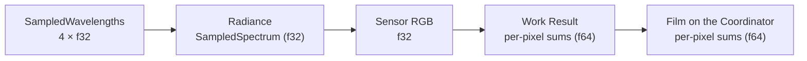

# 8. Crosscutting Concepts

## 8.1 Numerics and spectral representation

Umbra follows pbrt-v4's numeric model ([ADR 0001](../adr/0001-numeric-model.md)) and requires bit-identical results on every Worker architecture ([ADR 0002](../adr/0002-bit-identical-results-across-architectures.md)).

| Concern | Rule |
| --- | --- |
| Precision | `f32` throughout the rendering core; no `f64` option. `f64` only for the per-pixel sums in Work Results and the Film. |
| Spectrum | Spectral only. `SampledSpectrum` / `SampledWavelengths` with a constant `N_SPECTRUM_SAMPLES = 4`, backed by `Vec4`. Visible-wavelength sampling as in pbrt-v4. |
| Ray robustness | pbrt-v4 error bounds: `Interval`, `Point3fi`, a `pError` for every shape, `offset_ray_origin`, `spawn_ray_to`, `1 + 2γ(3)` in ray-box tests (also in SIMD). |
| RGB input | Jakob–Hanika RGB-to-spectrum tables generated in `build.rs` with `libm`; sRGB first, more colour spaces when a milestone needs them. Hash checked in CI. |
| Spectral data | pbrt-v4's CIE matching functions and named spectra as Rust `const` arrays (Apache-2.0, attributed in `NOTICE`). |
| Film | Pixel Samples are converted to sensor RGB on the Worker. Work Results carry `f64` weighted-RGB and weight sums per pixel. The Film sums in `f64`. Filter importance sampling only, so no cross-pixel splatting. |
| Math | A core `math` module ports pbrt-v4's helpers (`difference_of_products`, `sum_of_products`, `evaluate_polynomial`, compensated sums, `safe_sqrt`, `safe_asin`, `erf_inv`, …). Explicit `mul_add` where pbrt uses FMA, with hardware FMA required. Transcendentals from `libm`. No fast-math. |
| SIMD | No approximate `rcp`/`rsqrt`. Kernels are bit-identical to their scalar reference, which is the test oracle. Explicit NaN semantics for `min`/`max`. |
| Floating-point state | IEEE defaults; never flush-to-zero or denormals-are-zero. |
| NaN / Inf | `debug_assert!` wherever pbrt-v4 has a `DCHECK`. |

The flow of numeric precision for one Pixel Sample:

