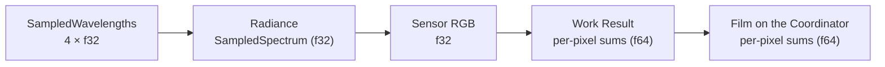
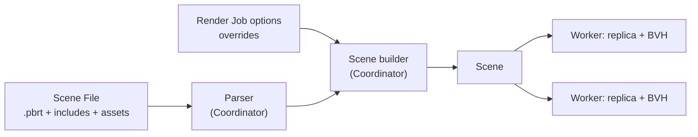
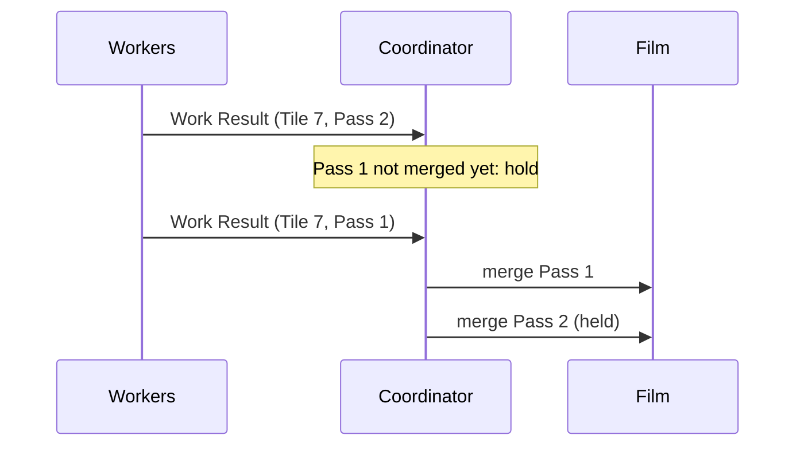
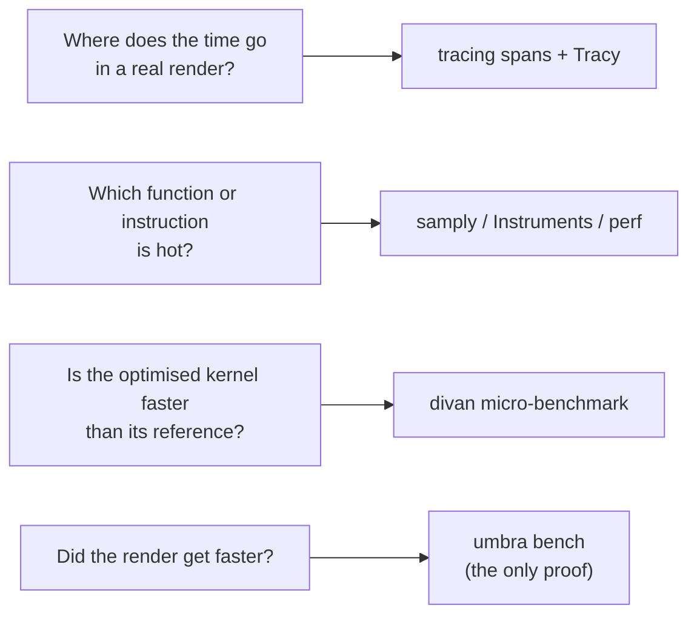
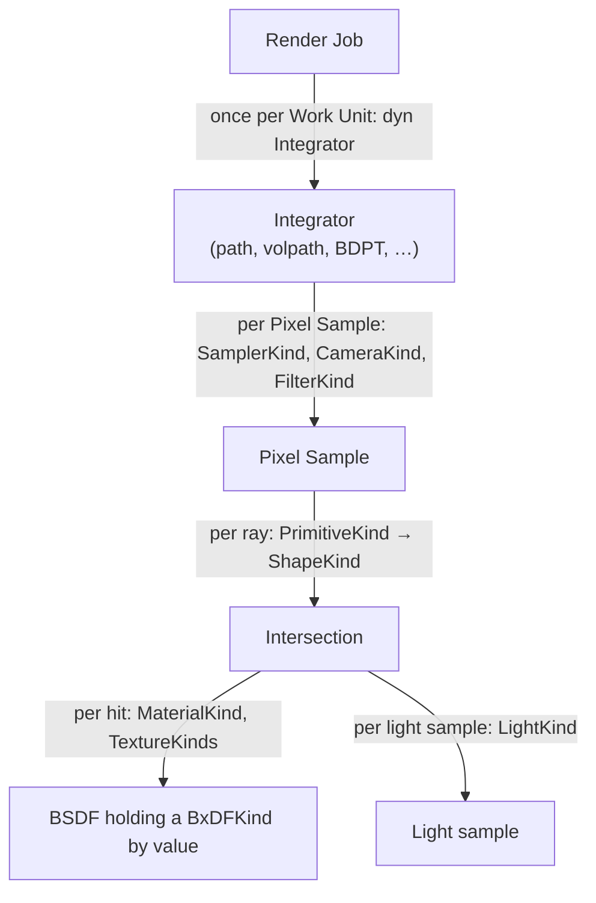
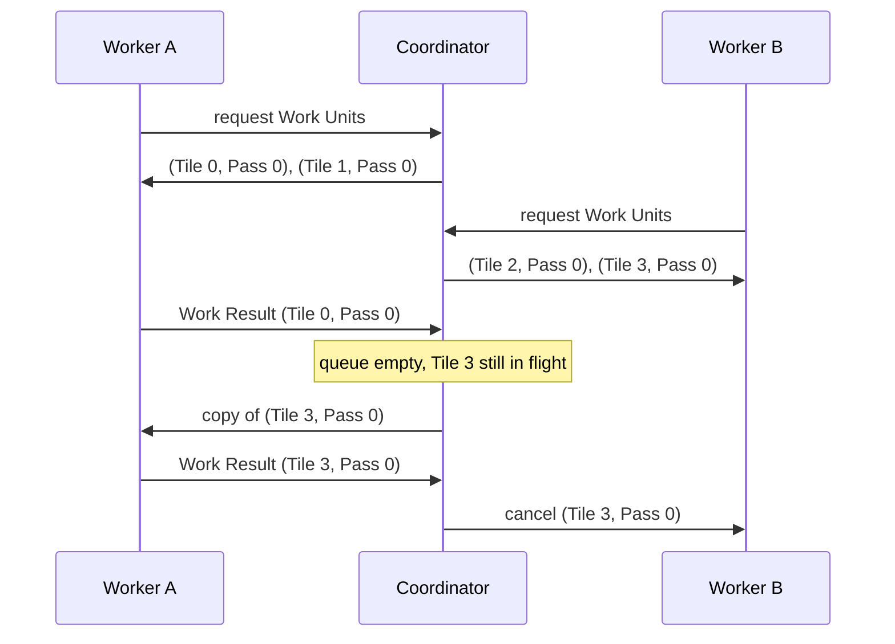

# 8. Crosscutting Concepts

## 8.1 Numerics and spectral representation

Umbra follows pbrt-v4's numeric model ([ADR 0001](../adr/0001-numeric-model.md)) and requires bit-identical results on every Worker architecture ([ADR 0002](../adr/0002-bit-identical-results-across-architectures.md)).

| Concern | Rule |
| --- | --- |
| Precision | `f32` throughout the rendering core; no `f64` option. `f64` only for the per-pixel sums in Work Results and the Film. |
| Spectrum | Spectral only. `SampledSpectrum` / `SampledWavelengths` with a constant `N_SPECTRUM_SAMPLES = 4`, backed by `Vec4`. Visible-wavelength sampling as in pbrt-v4. |
| Ray robustness | pbrt-v4 error bounds: `Interval`, `Point3fi`, a `pError` for every shape, `offset_ray_origin`, `spawn_ray_to`, `1 + 2γ(3)` in ray-box tests (also in SIMD). |
| RGB input | Jakob–Hanika RGB-to-spectrum tables generated in `build.rs` with `libm`; sRGB first, more colour spaces when a milestone needs them. Hash checked in CI. |
| Spectral data | pbrt-v4's CIE matching functions and named spectra as Rust `const` arrays (Apache-2.0, attributed in `NOTICE`). |
| Film | Pixel Samples are converted to sensor RGB on the Worker. Work Results carry `f64` weighted-RGB and weight sums per pixel. The Film sums in `f64`. Filter importance sampling only, so no cross-pixel splatting. |
| Math | A core `math` module ports pbrt-v4's helpers (`difference_of_products`, `sum_of_products`, `evaluate_polynomial`, compensated sums, `safe_sqrt`, `safe_asin`, `erf_inv`, …). Explicit `mul_add` where pbrt uses FMA, with hardware FMA required. Transcendentals from `libm`. No fast-math. |
| SIMD | No approximate `rcp`/`rsqrt`. Kernels are bit-identical to their scalar reference, which is the test oracle. Explicit NaN semantics for `min`/`max`. |
| Floating-point state | IEEE defaults; never flush-to-zero or denormals-are-zero. |
| NaN / Inf | `debug_assert!` wherever pbrt-v4 has a `DCHECK`. |

The flow of numeric precision for one Pixel Sample:

## 8.2 Scene input

Umbra reads pbrt-v4 Scene Files only, validates them strictly and parses them once on the Coordinator ([ADR 0003](../adr/0003-pbrt-v4-scene-files-parsed-on-the-coordinator.md)).

| Concern | Rule |
| --- | --- |
| Format | pbrt-v4 `.pbrt`, unextended, at a pinned `mmp/pbrt-v4` commit. Each milestone declares the supported subset. No pbrt-v3, no custom format. |
| Validation | Any unsupported directive, type or parameter rejects the Render Job before any Work Unit is assigned. All uses are reported, each with `file:line:column`. Recognised but unused parameters produce a warning. |
| Parser | `nom` + `nom_locate` for the lexical layer and directives, behind a `ParserTarget`-style interface. Graphics state and Scene builder follow pbrt-v4. |
| Replication | The Coordinator builds a format-independent Scene, with assets referenced by content hash, and replicates it to every Worker. Workers build their own acceleration structures. |
| Render Job options | Tile size, Pixel Samples per Pass and Workers are given at submission, never in the Scene File. pbrt-v4-style overrides (`--spp`, `--seed`, …) take precedence and are applied when the Scene is built. |

## 8.3 Determinism

For a fixed Scene, seed and Render Job options, the final Film is bit-identical regardless of Workers, threads, arrival order or failures ([ADR 0004](../adr/0004-deterministic-film-for-a-fixed-render-job.md)).

| Concern | Rule |
| --- | --- |
| Scope | Fixed: Scene, seed, Tile size, Pixel Samples per Pass. Free: number of Workers, Worker and thread per Work Unit, arrival order, failures and reassignments. Changing the decomposition may change the last bit. |
| Sampling | A Pixel Sample is a pure function of `(Scene, seed, pixel, sample index)`. pbrt-v4 samplers, hashes (`MixBits`, `MurmurHash64A`), PCG32 and Sobol tables are ported faithfully. No randomness outside the sampler on the render path, enforced by lint. Default seed 0, `--seed` overrides it. |
| Work Result order | Each pixel sums its Pixel Samples in ascending sample index. Threads split a Work Unit by pixel. |
| Film order | Per Tile, Work Results are merged in Pass order. Early arrivals wait on the Coordinator. |
| Splats | Cross-Tile contributions go into a separate splat accumulator, merged in the total order (Pass, Tile index). MLT and SPPM designs must preserve the guarantee. |
| BVH | A pure function of the Scene: stable SAH partitioning, explicit tie-breaks, parallelism only over disjoint subtrees joined in a fixed order. |
| Termination | Every Render Job renders all its Passes. No time budget, no adaptive sampling. Cancelling produces no image. |
| Verification | Film-hash tests in CI on arm64 and x86-64. Invariance tests (thread count, Work Unit order, simulated Worker failure). A 64-bit hash per Work Result, compared when duplicates arrive. An opt-in `verify` Render Job option. |

Merge order for one Tile on the Coordinator:

## 8.4 Performance measurement

How performance claims are measured and guarded ([Benchmark and profiling infrastructure](https://github.com/sergioffpc/umbra/issues/14)). It backs the rule that an aggressive optimisation needs a benchmark showing the gain.

| Concern | Rule |
| --- | --- |
| Proof of a gain | An optimisation is accepted only on an end-to-end gain: one Worker, no network, on the Reference Scenes. Micro-benchmarks help to iterate and to locate a gain, but never justify one on their own. |
| Metrics | The main metric is Pixel Samples per second in the render phase (wall-clock, all threads of the Worker). Each other phase is timed on its own: parse, Scene build, BVH build. Umbra writes them as a structured JSON report at the end of every Render Job. |
| Reference Scenes | Taken only from `mmp/pbrt-v4-scenes` at a pinned commit, downloaded and never vendored. Each milestone adds the ones it can render, and none is ever removed. Each entry fixes resolution, Pixel Samples per pixel, seed and Tile size, sized for 10–60 s per machine. |
| Where | Measured by hand on the three target machines (§7.1) with `umbra bench`, and the report is attached to the PR. Arm64 (M2) is required for NEON changes, at least one x86-64 machine for AVX2 changes, and the R630 for any threading or memory change (NUMA). Shared CI runners only smoke-test: `cargo bench --no-run` and one small Scene rendered to completion, with no numbers compared. |
| No remote triggers | No self-hosted runners and no GitHub-triggered execution on the target machines. Every measurement on them is started by hand. |
| Noise | Baseline and candidate commits run interleaved (A, B, A, B, …) on the same idle machine: 1 discarded warm-up, then 5 runs each. A gain counts if the 95 % confidence interval of the difference excludes zero and the median gain is ≥ 2 %. The report records the CPU model, OS, commit, build flags, and the governor and frequency when available. |
| Regressions | Every milestone ends with a benchmark measurement issue, run by hand on all three machines against the previous milestone. Results are committed to `docs/benchmarks/<milestone>/<machine>.json`. A regression above 2 % blocks closing the milestone until it is fixed or explained. |
| Distribution | From the milestone that introduces distribution, the measurement issue also records three numbers. Scaling efficiency is the cluster's Pixel Samples per second divided by the sum of each Worker's standalone rate. The other two are Scene replication time and Worker idle time (no Work Unit). A drop of more than 2 percentage points in efficiency blocks the milestone. |
| pbrt-v4 reference | The measurement issue also renders each Reference Scene with pbrt-v4 (CPU, pinned commit) on the same machine, at the same resolution, Pixel Samples per pixel and thread count. The Umbra / pbrt-v4 ratio is recorded for information and never blocks. Targets belong to the quality goals. |
| Micro-benchmarks | `divan` in `benches/`. A readable reference and its optimised version are benchmarked side by side in one generic bench, and `AllocProfiler` checks the allocation-free core. |
| Instrumentation | Coarse `tracing` spans only: Render Job, each phase, Work Unit, Work Result send and merge. Never inside the rendering core, never per Pixel Sample or per ray. Tracy via `tracing-tracy` behind the Cargo feature `tracy`, off by default. |
| Profilers | Sampling profilers on the `profiling` build profile: samply on all three machines, plus Instruments on macOS and `perf` (hardware counters) on Linux. |

What answers which question:

## 8.5 Polymorphism

How pbrt-v4's interfaces are dispatched in Rust ([ADR 0006](../adr/0006-closed-enum-dispatch-for-rendering-interfaces.md)). The rule follows how often a call happens: closed enums on the per-ray and per-Pixel-Sample path, `dyn Trait` only at coarse seams.

| Concern | Rule |
| --- | --- |
| Hot-path interfaces | Shape, Primitive (acceleration structure included), Material, BxDF, Light, FloatTexture, SpectrumTexture, Medium, PhaseFunction, Sampler, Camera and Filter dispatch through a closed `enum` and `match`. Never `dyn`. |
| Shape of an interface | A trait with the book's name is the contract (`trait Shape`). Concrete types keep pbrt-v4's names (`Sphere`, `DiffuseBxDF`) and implement it. The enum is `<Interface>Kind` (`ShapeKind`) and implements the trait with a hand-written `match` per method. pbrt-v4's `LightType` keeps its name, distinct from `LightKind`. |
| Exhaustive matches | No `_` arm in a `match` on a `*Kind` enum. Enforced crate-wide by lint (§8.6). |
| Fixed per Render Job | Sampler, Camera and Filter are still matched per call. Hoisting the `match` into a monomorphised loop is an aggressive optimisation (benchmark, isolated contract, per-call version as reference). |
| Generics | Free when they are not interface dispatch (`Vector3<T>`, `Bounds3<T>`). |
| `dyn Trait` | Only for code called at most once per Work Unit or outside rendering: `dyn Integrator`, network transport, image writers, `ParserTarget`, telemetry. |
| BxDF lifetime | Returned by value as `BxDFKind` and held on the stack inside the `BSDF`. `size_of::<BxDFKind>() <= 256` is asserted at compile time. `MixMaterial` picks one material stochastically, so there is no mixed BxDF. |
| Textures | `FloatTextureKind` and `SpectrumTextureKind`. No `TextureEvaluator` until a wavefront driver needs it. |

Where each dispatch mechanism sits, by call frequency:

## 8.6 Unsafe code and lints

What the compiler and clippy enforce beyond style ([Unsafe policy and lint configuration](https://github.com/sergioffpc/umbra/issues/21)). The full lint set lives in `[lints]` in `Cargo.toml` and in `clippy.toml`. `CONTRIBUTING.md` explains it for contributors. Every warning is an error in CI.

| Concern | Rule |
| --- | --- |
| `unsafe` | Denied crate-wide. An exception is an aggressive optimisation (benchmark, safe contract, tested safe reference) opened with `#[expect(unsafe_code, reason)]` on the narrowest item ([ADR 0007](../adr/0007-unsafe-code-as-an-aggressive-optimisation.md)). No module is unsafe by default. |
| `unsafe` documentation | One unsafe operation per block, a `// SAFETY:` comment on every block, a `# Safety` section on every `unsafe fn`, and no `SAFETY` comments on safe code. |
| `unsafe` verification | Tests of every `unsafe` item run under Miri in CI (nightly pinned for that job), or under AddressSanitizer on Linux where Miri cannot execute the code. The job lands with the first exception. |
| Exhaustive dispatch | No `_` arm in a `match` on an enum (`wildcard_enum_match_arm`, `match_wildcard_for_single_variants`), so a new `*Kind` variant breaks the build wherever it is not handled (§8.5). On a `#[non_exhaustive]` foreign enum, a `_` arm is allowed after listing the known variants. |
| Bit-identical numerics | `disallowed-methods` bans `std`'s transcendental `f32`/`f64` methods (platform libm), approximate reciprocal intrinsics (`rcp`, `rsqrt`, `vrecpe`, `vrsqrte`, `wide`'s `recip`) and FP control-register writes (flush-to-zero, denormals-are-zero). Tests are not exempt ([ADR 0002](../adr/0002-bit-identical-results-across-architectures.md)). |
| Output | No `print!`/`eprint!` outside tests: output goes through `tracing` and the JSON report (§8.4). |
| Silencing | `#[expect(lint, reason = "...")]` on the narrowest item. `#[allow]` and reasonless attributes are rejected. |

## 8.8 Work scheduling

How a Render Job is split and scheduled across Workers and cores ([ADR 0009](../adr/0009-pull-based-pass-major-scheduling.md), [ADR 0010](../adr/0010-quic-transport-between-coordinator-and-workers.md)).

| Concern | Rule |
| --- | --- |
| Decomposition | Square Tiles, 32 × 32 by default; Passes of 64 Pixel Samples by default. Both are Render Job options, never derived from the cluster. |
| Assignment | Workers pull Work Units, about two in flight per eight threads. Pass-major order, raster Tile order within a Pass. Pass p of a Tile waits until Pass p − 2 of that Tile is merged. |
| Inside a Worker | One rayon pool. Work Units in flight run concurrently, each splitting its rows with `par_iter`. No thread pinning by default. |
| Failure detection | Connection closed, or 5 s without a heartbeat (sent every second). Both are Coordinator options. No per-Work-Unit timeout. |
| Reassignment | A dead Worker's Work Units go to the front of the queue. A reconnecting Worker joins as new. The first Work Result per Work Unit is accepted; later ones are hash-compared and discarded. With no Workers, the Render Job waits. |
| Tail | Once the queue is empty, the oldest Work Unit in flight is copied to a free Worker, at most once. The first Work Result wins, the other is cancelled. |
| Transport | QUIC (`quinn`) to remote Workers; an in-memory transport to the Coordinator's optional local Worker. |

