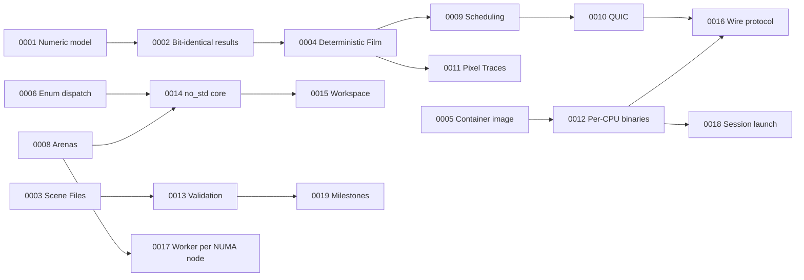

# 9. Architecture Decisions

Hard-to-reverse decisions are recorded as ADRs in [`docs/adr/`](../adr/), one file each, numbered in the order they were taken. An ADR is never rewritten to change its decision: a later ADR amends or supersedes it, and the earlier one gets a note at the top. Every ADR links the issue on the [Umbra implementation plan](https://github.com/sergioffpc/umbra/issues/9) where it was decided, and the section of this document that describes its result.

| ADR | Decision | Status | Described in |
| --- | --- | --- | --- |
| [0001](../adr/0001-numeric-model.md) | Numeric model: `f32`, spectral-only, pbrt-v4 error bounds | Accepted | §8.1 |
| [0002](../adr/0002-bit-identical-results-across-architectures.md) | Bit-identical Work Results on arm64 and x86-64 | Accepted | §8.1 |
| [0003](../adr/0003-pbrt-v4-scene-files-parsed-on-the-coordinator.md) | pbrt-v4 Scene Files only, parsed once on the Coordinator | Accepted | §8.2 |
| [0004](../adr/0004-deterministic-film-for-a-fixed-render-job.md) | Deterministic Film for a fixed Render Job | Accepted | §8.3 |
| [0005](../adr/0005-chiseled-release-container-image.md) | Chiseled Ubuntu container image on every release tag | Accepted, amended by 0012 | §7.2 |
| [0006](../adr/0006-closed-enum-dispatch-for-rendering-interfaces.md) | Closed enum dispatch for rendering interfaces | Accepted | §8.5 |
| [0007](../adr/0007-unsafe-code-as-an-aggressive-optimisation.md) | `unsafe` code only as an aggressive optimisation | Accepted | §8.6 |
| [0008](../adr/0008-index-handle-arenas-and-allocation-free-rendering.md) | Index-handle arenas and allocation-free rendering | Accepted, amended by 0014 and 0017 | §8.7 |
| [0009](../adr/0009-pull-based-pass-major-scheduling.md) | Pull-based, Pass-major scheduling with speculative tail | Accepted | §8.8 |
| [0010](../adr/0010-quic-transport-between-coordinator-and-workers.md) | QUIC transport between Coordinator and Workers | Accepted | §8.8, §8.13 |
| [0011](../adr/0011-pixel-traces-by-deterministic-re-execution.md) | Pixel Traces by deterministic re-execution through a monomorphised `Recorder` | Accepted | §8.9 |
| [0012](../adr/0012-per-cpu-binaries-locked-to-one-commit.md) | Per-CPU binaries, locked to one commit per Render Job | Accepted, amended by 0018 | §7.2, §7.3 |
| [0013](../adr/0013-statistical-validation-against-a-published-pbrt-v4-reference.md) | Statistical validation against a published pbrt-v4 reference | Accepted, amended by 0019 | §8.11 |
| [0014](../adr/0014-gpu-ready-no-std-rendering-core.md) | A GPU-ready `no_std` rendering core | Accepted | §8.12 |
| [0015](../adr/0015-layered-workspace-with-a-seven-crate-no-std-core.md) | A layered workspace with a seven-crate `no_std` core | Accepted | §5 |
| [0016](../adr/0016-one-render-job-per-quic-connection.md) | Wire protocol: one Render Job per QUIC connection, unverified TLS | Accepted | §8.13 |
| [0017](../adr/0017-one-worker-per-numa-node.md) | One Worker per NUMA node | Accepted | §7.3, §8.14 |
| [0018](../adr/0018-sessions-launched-from-the-operators-machine.md) | Sessions launched from the operator's machine | Accepted | §7.3 |
| [0019](../adr/0019-milestones-defined-by-the-reference-scenes-they-unlock.md) | Milestones defined by the Reference Scenes they unlock | Accepted | §4.1 |

How the ADRs build on one another:

Arrows point from a decision to one that depends on it, amends it or refines it. Decisions that needed no ADR, because they are easy to reverse, are recorded only in their issue and in section 8.
