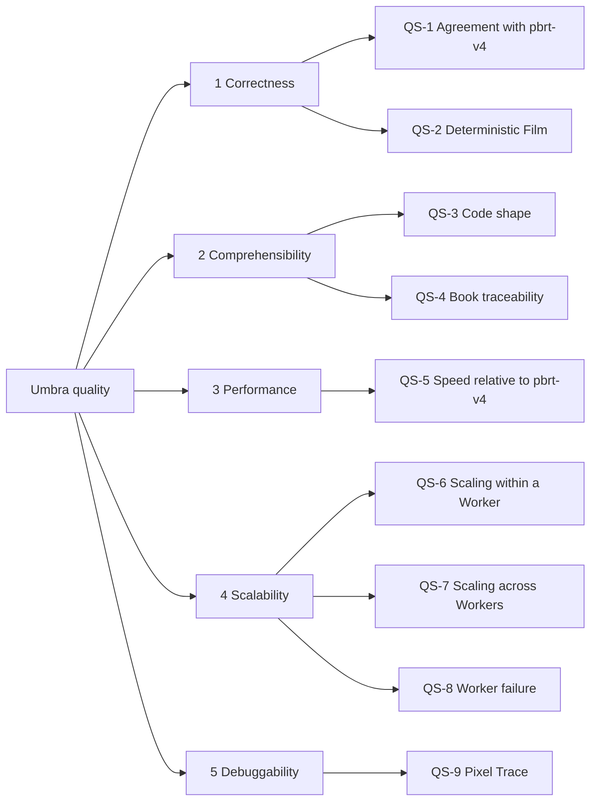

# 10. Quality Requirements

Measurable targets for the quality goals of section 1.2, decided in [Quality goals and measurable targets](https://github.com/sergioffpc/umbra/issues/28). How performance is measured is section 8.4. How correctness is validated is section 8.11. Which milestone each target first applies to is section 4.1.

## 10.1 Quality tree

## 10.2 Quality scenarios

Unless stated otherwise, a target is checked on every Reference Scene by the benchmark measurement issue that closes each milestone (section 8.4), and a missed target blocks closing that milestone.

| Id | Goal | Scenario | Target |
| --- | --- | --- | --- |
| QS-1 | Correctness | A Reference Scene is rendered by Umbra and by pbrt-v4 (pinned commit) at its benchmark settings (section 8.4), and both are compared with its Reference Image. | relMSE(Umbra, Reference Image) ≤ 1.05 × relMSE(pbrt-v4, Reference Image). The Reference Image is rendered once per pinned commit by pbrt-v4 at 64 × the Reference Scene's Pixel Samples per pixel. |
| QS-2 | Correctness | The same Render Job runs on the M2 alone, on the P620 alone, and on the cluster with one Worker killed halfway. | The three Films have the same hash: 100 % bit-identical. |
| QS-3 | Comprehensibility | A contributor adds or changes a function. | The lints of `CONTRIBUTING.md` pass with no unexplained exception: at most 40 lines, cognitive complexity at most 10, nesting at most 3, at most 5 arguments, docs on every public item. Checked on every commit. |
| QS-4 | Comprehensibility | A reader with the book open looks for the implementation of a section it covers. | 100 % of the rendering-core items that implement a pbrt-v4 algorithm cite, in their doc comment, the book section (`PBR 4e §9.3.2`) and the pbrt-v4 symbol. A CI check rejects an omission and generates the index `docs/book-map.md` from section to code. Checked on every commit. |
| QS-5 | Performance | A Reference Scene is rendered by Umbra and by pbrt-v4 on the same machine, at the same resolution, Pixel Samples per pixel and thread count. | Every milestone: the geometric mean of the Umbra / pbrt-v4 speed ratio over the Reference Scenes is ≥ 0.5 on each machine. Last milestone: ≥ 1.0 on each machine, with no Reference Scene below 0.8. |
| QS-6 | Scalability | A machine renders a Reference Scene with one thread on one Worker, then with one thread per physical core (no SMT, no E-cores) spread over its Workers, one per NUMA node. | Efficiency = rate with N threads / (N × rate with 1 thread): ≥ 85 % on the P620 (32 cores), ≥ 85 % on the M2 (8 P-cores), ≥ 75 % on the R630 (28 cores over 2 NUMA nodes). Missing a target reopens that machine's threading and memory entries of the tuning backlog (section 8.14), on the R630 first the in-process NUMA replica. |
| QS-7 | Scalability | The three machines render a Reference Scene together over 1 GbE. | Scaling efficiency (section 8.4) ≥ 90 %, from the milestone that introduces distribution. A drop of more than 2 percentage points from the previous milestone also blocks. |
| QS-8 | Scalability | A Worker is killed while a Render Job runs. | The Render Job finishes without intervention. The delay is at most the 5 s detection time plus the time to render the lost Work Units again, and the final image is unchanged (QS-2). |
| QS-9 | Debuggability | A developer runs `umbra trace` on any pixel of a finished image of a Reference Scene. | It finishes in ≤ 2 × (parse + Scene build + BVH build) + 1 s, and the value the Pixel Trace reconstructs is bit-identical to that Pixel Sample's contribution to the Film. Every integrator has a test of this. |
